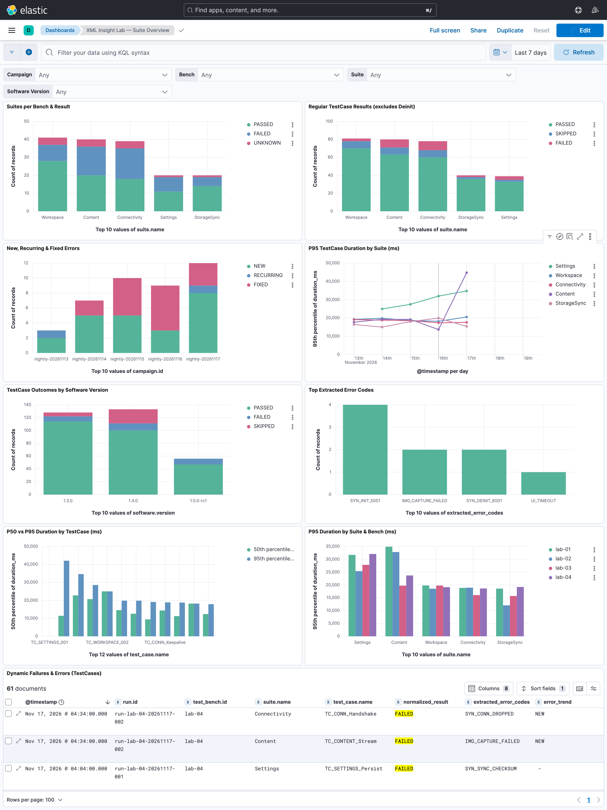
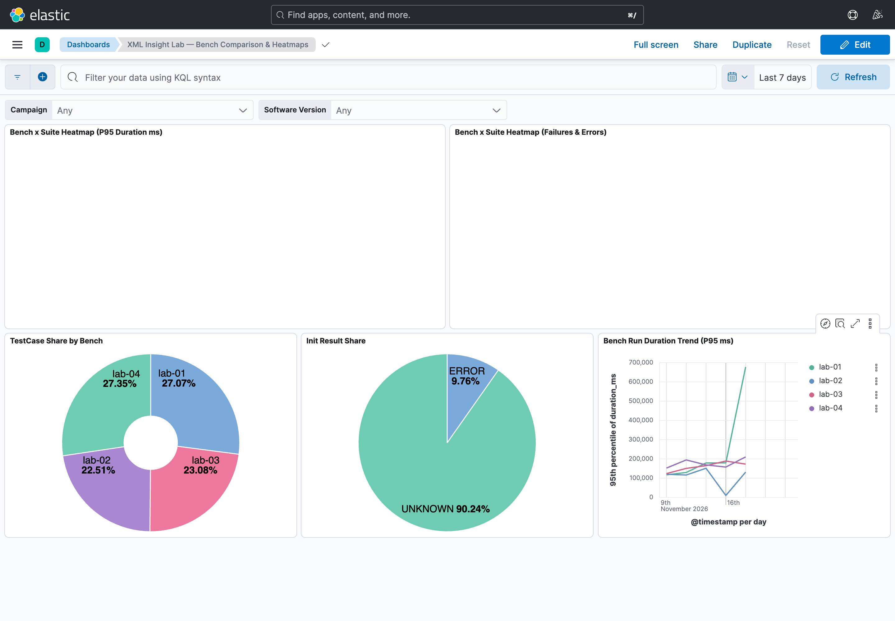
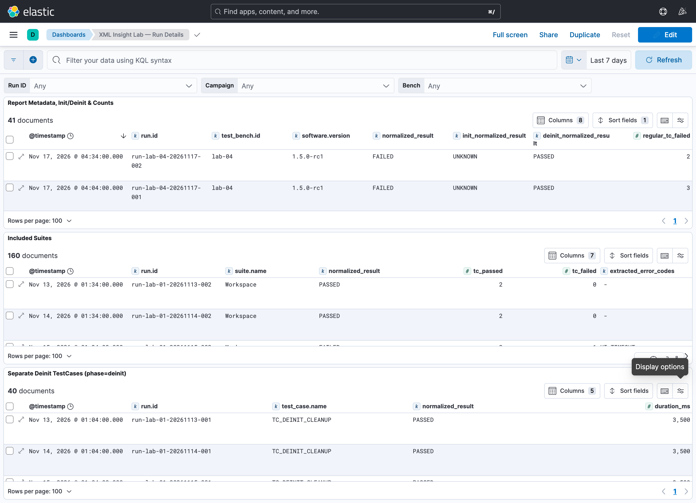

# XML Insight Lab — Project Showcase

**XML Insight Lab** is a fully containerized Elastic Stack (`8.17.4`) analytics platform implemented in `project/` for ingesting, validating, normalizing, and visualizing synthetic `<report>` XML test execution reports across multiple test benches (`lab-01`–`lab-04`), suites (`Workspace`, `Content`, `Settings`, `Connectivity`, `StorageSync`), and nightly campaigns.

## Data Flow & Modeling Summary

- **Ingestion:** A Python CLI reads complete XML files, computes SHA-256 hashes, strips local paths, and sends JSON envelopes to Logstash HTTP input (`:8080`).
- **Normalization (`normalize_report.rb`):** Rejects DTDs/entities, converts naive local timestamps (`SOURCE_TIMEZONE=Europe/Berlin`) to UTC, converts `duration` (seconds) to `duration_ms`, preserves `source_result` alongside `normalized_result`, and validates before splitting.
- **Elasticsearch (7 strict index families):** `xml-insight-runs-v1`, `xml-insight-suites-v1`, `xml-insight-testcases-v1` (separating `phase: "suite"` vs. `phase: "deinit"`), `xml-insight-steps-v1`, `xml-insight-messages-v1`, `xml-insight-errors-v1`, and `xml-insight-plan-status-v1`.

---

## Dashboard Gallery

### 1. Nightly Overview
Tracks planned vs. received vs. missing vs. partial vs. invalid reports, bench-level result distribution, `init`/`deinit` anomalies, P50/P95 run duration trends, and dynamic failure/import-error tables.

---

### 2. Suite Overview
Compares suite execution outcomes across benches, regular `testCase` results (excluding `deinit`), `NEW`/`RECURRING`/`FIXED` error trends, P95 duration trends, software version impact, and top extracted error codes (`UI_TIMEOUT`, `IMG_CAPTURE_FAILED`, `SYN_CONN_DROPPED`).

---

### 3. Bench Comparison & Heatmaps
Uses `lnsHeatmap`, `lnsPie` (donut/pie), and `lnsXY` line charts to surface cross-bench latency and failure hotspots (e.g., `lab-04` Connectivity failures and `lab-02` Init errors).

---

### 4. Error & Retry Analytics
Breaks down failures by `error_category`, `error_trend` (`NEW` / `RECURRING` / `FIXED`), message `level`, horizontal error code frequency, and retry recovery (`attempt > 1`).

---

### 5. Software Version & Regression Lab
Highlights regressions across software builds (`1.3.0` → `1.4.0` → `1.5.0-rc1`) using version × testCase heatmaps, plan suite completeness, and data quality flags.

---

### 6. Bench & Suite Failure Matrix (Aggregated Lens Data Tables)
Uses aggregated **Lens Data Tables (`lnsDatatable`)** and a nested Bench → Suite sunburst donut to summarize failure counts and P95 durations without scrolling raw document rows.

---

### 7. TestCase & Error Matrix (Aggregated Lens Data Tables)
Provides grouped `lnsDatatable` matrices for software regressions, error codes by bench and testCase, retry outcomes, and message origin/level counts.

---

### 8. Run Details
Focused drilldown view for a single `run.id`, showing report metadata (`init` / `deinit` / `regular_tc_failed`), included suites, and separate `deInitialization` testCase evaluation (`phase: "deinit"`).

