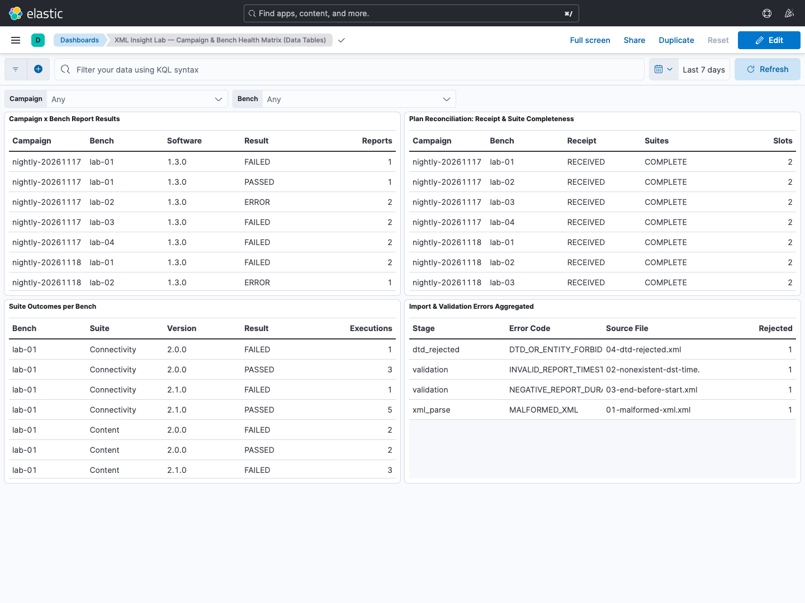

# XML Insight Lab — Project Showcase

**XML Insight Lab** is a fully containerized Elastic Stack (`8.17.4`) analytics platform implemented in `project/` for ingesting, validating, normalizing, classifying, and visualizing `<report>` XML test execution reports across multiple test benches (`lab-01`–`lab-04`), suites (`Workspace`, `Content`, `Settings`, `Connectivity`, `StorageSync`), software versions (`1.3.0`, `1.4.0`, `1.5.0-rc1`), and nightly campaigns.

> **Deep Dive Documentation:** See **[Section 5: Logstash Deep Dive, XML Pipelines & Error Mapping](sections/05-logstash-pipelines-and-xml-normalization/index.html)** for a complete chapter-by-chapter technical guide covering `xml-insight.conf`, `normalize_report.rb`, `error_mapping.yaml`, deterministic SHA-256 routing, and Kibana visualization customization.

---

## Kibana Visualization Capabilities Matrix (15 Distinct Visualization Types)

To demonstrate the full visual analytics power of Kibana `8.17.4`, our 12 provisioned dashboards combine **15 distinct visualization paradigms** across **Kibana Lens**, **Classic Aggregation Visualizations**, and **Vega Custom Grammar**:

| # | Kibana Visualization Type | Technical Type (`visualizationType` / `visState.type`) | Where It Is Used in Our Dashboards |
| :--- | :--- | :--- | :--- |
| **1** | **KPI Metric Card** | `lens` → `lnsMetric` | Top KPI summary rows across Dashboards `01`, `02`, `05`, `09`, `10`, `11`, `12` |
| **2** | **Arc Gauge** | `lens` → `lnsGauge` (`shape: "arc"`) | `Complete Plan Slots (38 / 40)` on Dashboard `12` |
| **3** | **Horizontal Bullet Gauge** | `lens` → `lnsGauge` (`shape: "horizontalBullet"`) | `Received Plan Reports (39 / 40)` on Dashboard `12` |
| **4** | **Hierarchical Treemap** | `lens` → `lnsPie` (`shape: "treemap"`) | `Error Category × Rule ID` (Dashboards `04`, `12`) & `Owner × Root Cause` (Dashboard `09`) |
| **5** | **Waffle Grid Chart** | `lens` → `lnsPie` (`shape: "waffle"`) | `Diagnostic Message Disposition` (Dashboards `09`, `12`) & `Failure Share by Software Version` (Dashboard `05`) |
| **6** | **Multi-Ring Sunburst / Donut** | `lens` → `lnsPie` (`shape: "donut"`) | `Bench → Suite Failure Sunburst` (Dashboards `06`, `12`), `Disposition` & `Owner` shares |
| **7** | **Pie Chart** | `lens` → `lnsPie` (`shape: "pie"`) | `Init Result Share` (`03`) & `Error Trend NEW/RECURRING/FIXED` (`04`) |
| **8** | **Vertical Stacked Bar Chart** | `lens` → `lnsXY` (`bar_stacked`) | Bench results, Version × Suite, Root Cause × Severity across Dashboards `01`, `02`, `05`, `09` |
| **9** | **Horizontal Bar Chart** | `lens` → `lnsXY` (`bar_horizontal`) | Top Extracted Error Codes (`02`, `04`), Data Quality Flags (`05`), Matched Rule IDs (`09`) |
| **10** | **100% Percentage Stacked Bar** | `lens` → `lnsXY` (`bar_percentage_stacked` & `bar_horizontal_percentage_stacked`) | `100% TestCase Outcome Share by Bench` (`03`, `12`) & `by Suite` (`02`) |
| **11** | **Dual-Axis Combo Chart (Bars + Line)** | `lens` → `lnsXY` (`bar` + `line` overlay) | `Total Executions (Bars) vs. Failures (Line) by Suite` (Dashboards `02`, `12`) |
| **12** | **Stacked Area & Multi-Series Line Trend** | `lens` → `lnsXY` (`area_stacked`, `line`) | Nightly TestCase status trends (`01`), Error trends (`02`), and Bench failure trends (`03`) |
| **13** | **Tag Cloud (Word Cloud)** | `visualization` → `tagcloud` | `Matched Error Rules` (Dashboards `04`, `12`) & `Classified Root Causes` (Dashboard `09`) |
| **14** | **2D Color Heatmap Matrix** | `visualization` → `heatmap` | `Bench × Suite Failures` (`03`, `12`), `Bench × Error Category` (`03`), `Software Version × TestCase` (`05`) |
| **15** | **Vega-Lite Custom Bubble Matrix & Aggregated Lens Data Table** | `visualization` → `vega` & `lens` → `lnsDatatable` | Live ES-queried `Bench × Error Category Proportional Bubble Matrix` (`03`, `12`) & 28 clean `lnsDatatable` panels across all dashboards |

---

## Complete Dashboard Gallery (All 12 Dashboards)

### Featured: 12. Kibana Visualization Capabilities Showcase (`xml-insight-viz-showcase`)
Our flagship capability showcase displaying **12 distinct Kibana visualization types side by side on a single dashboard**: KPI Metric (`lnsMetric`), Arc Gauge (`lnsGauge`), Horizontal Bullet Gauge (`lnsGauge`), Hierarchical Treemap (`lnsPie`), Waffle Grid (`lnsPie`), Multi-Ring Sunburst (`lnsPie`), 100% Percentage Stacked Bar (`lnsXY`), Dual-Axis Bar+Line Combo Chart (`lnsXY`), Tag Cloud (`tagcloud`), 2D Color Heatmap (`heatmap`), Vega-Lite Custom Bubble Matrix (`vega`), and an aggregated Lens Data Table (`lnsDatatable`).

---

### 1. Nightly Overview (`xml-insight-nightly-overview`)
Tracks planned vs. received vs. missing vs. partial vs. invalid reports, bench-level result distribution, `init`/`deinit` anomalies, daily failure categories, stacked area trends, and three aggregated **Lens Data Tables (`lnsDatatable`)** for Plan Status, Dynamic Failures & Errors, and Malformed/Rejected XML Import Errors.

---

### 2. Suite Overview (`xml-insight-suite-overview`)
Compares suite execution outcomes across test benches, regular `testCase` results (`phase: "suite"`, excluding `deinit`), `NEW` / `RECURRING` / `FIXED` error trends, software version distribution, top extracted error codes, an aggregated `lnsDatatable` of failed suites, a **Dual-Axis Combo Chart (`Total Executions vs. Failures by Suite`)**, and a **100% Horizontal Percentage Stacked Bar (`100% TestCase Outcome Share by Suite`)**.

---

### 3. Bench Comparison & Heatmaps (`xml-insight-bench-comparison`)
Combines **two 2D Color Heatmaps (`Bench × Suite Failure Matrix` and `Bench × Error Category Matrix`)**, a **100% Percentage Stacked Bar (`100% TestCase Outcome Share by Bench`)**, Donut/Pie shares, a multi-series daily failure line chart, and a custom **Vega-Lite Proportional Bubble Matrix (`Bench × Error Category Bubbles`)**.

---

### 4. Error & Retry Analytics (`xml-insight-error-analytics`)
Breaks down failures by `error_mapping.category` (Donut), `error_trend` (`NEW` / `RECURRING` / `FIXED` Pie), diagnostic message `level` (Donut), horizontal error code frequency, retry recovery (`attempt > 1`), an aggregated `lnsDatatable` of dynamic testCase failures, a **Hierarchical Treemap (`Error Category × Rule ID`)**, and a **Tag Cloud (`Matched Error Rules`)**.

---

### 5. Software Version & Regression Lab (`xml-insight-version-regression`)
Highlights regressions across software builds (`1.3.0` → `1.4.0` → `1.5.0-rc1`) with 4 KPI cards, stacked bar breakdowns by Suite, Error Category, and TestCase, two aggregated `lnsDatatable` summaries (`Version Health Summary` and `Version x Error Rule Breakdown`), plan suite completeness, data quality flags, a **2D Color Heatmap (`Software Version × TestCase Failures`)**, and a **Waffle Grid (`Failure Share by Software Version`)**.

---

### 6. Bench & Suite Failure Matrix (`xml-insight-bench-suite-matrix`)
Uses aggregated **Lens Data Tables (`lnsDatatable`)** and a nested Bench → Suite multi-ring sunburst donut to summarize total testCase counts, failure counts, and error category breakdowns across every `test_bench.id` × `suite.name` combination.

---

### 7. TestCase & Error Matrix (`xml-insight-testcase-matrix`)
Provides four grouped `lnsDatatable` matrices covering Software Version × TestCase regressions, top extracted error codes by Bench and TestCase, retry attempt outcomes (`attempt > 1`), and message origin/level distributions (`group_msg`, `step_msg`, `errors_block`).

---

### 8. Campaign & Bench Health Matrix (`xml-insight-campaign-matrix`)
Aggregates multi-night campaign health across four `lnsDatatable` views: Campaign × Bench run outcomes, nightly plan completeness (`COMPLETE`, `PARTIAL`, `NONE`, `MISSING`), suite execution summaries, and XML import validation errors.

---

### 9. Error Classification & Root Cause Analysis (`xml-insight-error-classification`)
Dedicated dashboard for the config-driven Error Mapping Engine (`error_mapping.yaml`), featuring 4 KPI cards (`Relevant Failures`, `Known Issues`, `Investigate Faults`, `Ignored Warnings`), breakdowns by `category`, `disposition`, `severity`, `root_cause`, and `owner`, two aggregated `lnsDatatable` views, plus an **Owner × Root Cause Hierarchical Treemap**, a **Diagnostic Message Disposition Waffle Grid**, and a **Classified Root Causes Tag Cloud**.

---

### 10. Run Details (`xml-insight-run-details`)
Focused drilldown view for run-level inspection, combining 4 KPI metrics (`Total Runs`, `Failed Runs`, `Suites Executed`, `Deinit Failures`) with three clean `lnsDatatable` panels: **Report Metadata & Init/Deinit Summary**, **Suites in Report**, and **Separate Deinit Evaluation** (`phase: "deinit"`).

---

### 11. Test Details (`xml-insight-test-details`)
Step- and message-level diagnostic view with 4 KPI metrics (`Total Steps`, `Failed Steps`, `Error Messages`, `Mapped Error Rules`) and three clean `lnsDatatable` panels: **Step Results by TestCase & Step**, **Failed Steps & Error Mapping** (`Category`, `Rule ID`), and **Messages & Explicit `<errors>` Entries** (`Phase`, `Origin`, `Level`, `Category`, `Message`, `Occurrences`).

---

## Official References & Further Reading

- [Kibana Guide — Create Visualizations with Lens (`lnsDatatable`, `lnsXY`, `lnsPie`, `lnsGauge`, `lnsMetric`)](https://www.elastic.co/guide/en/kibana/current/lens.html)
- [Kibana Guide — Vega & Vega-Lite Custom Visualizations in Kibana](https://www.elastic.co/guide/en/kibana/current/vega.html)
- [Logstash Reference — XML Filter Plugin (`store_xml`, `remove_namespaces`)](https://www.elastic.co/guide/en/logstash/current/plugins-filters-xml.html)
- [Logstash Reference — Ruby Filter Plugin (`register`, `filter`, `script_params`)](https://www.elastic.co/guide/en/logstash/current/plugins-filters-ruby.html)
