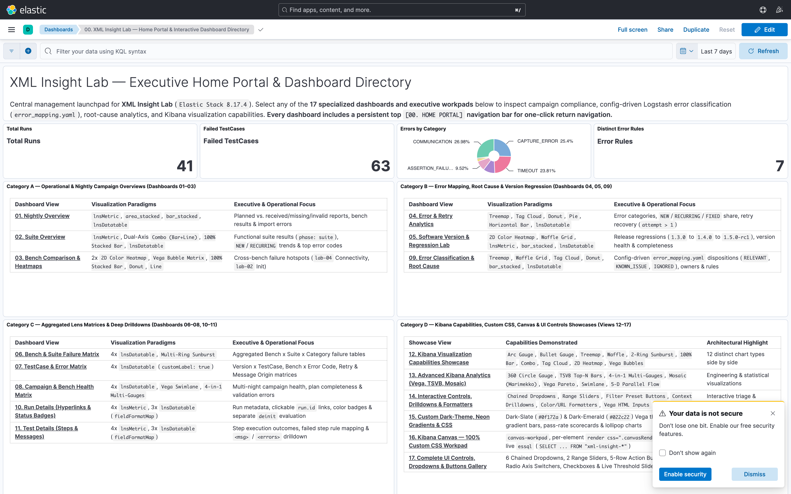
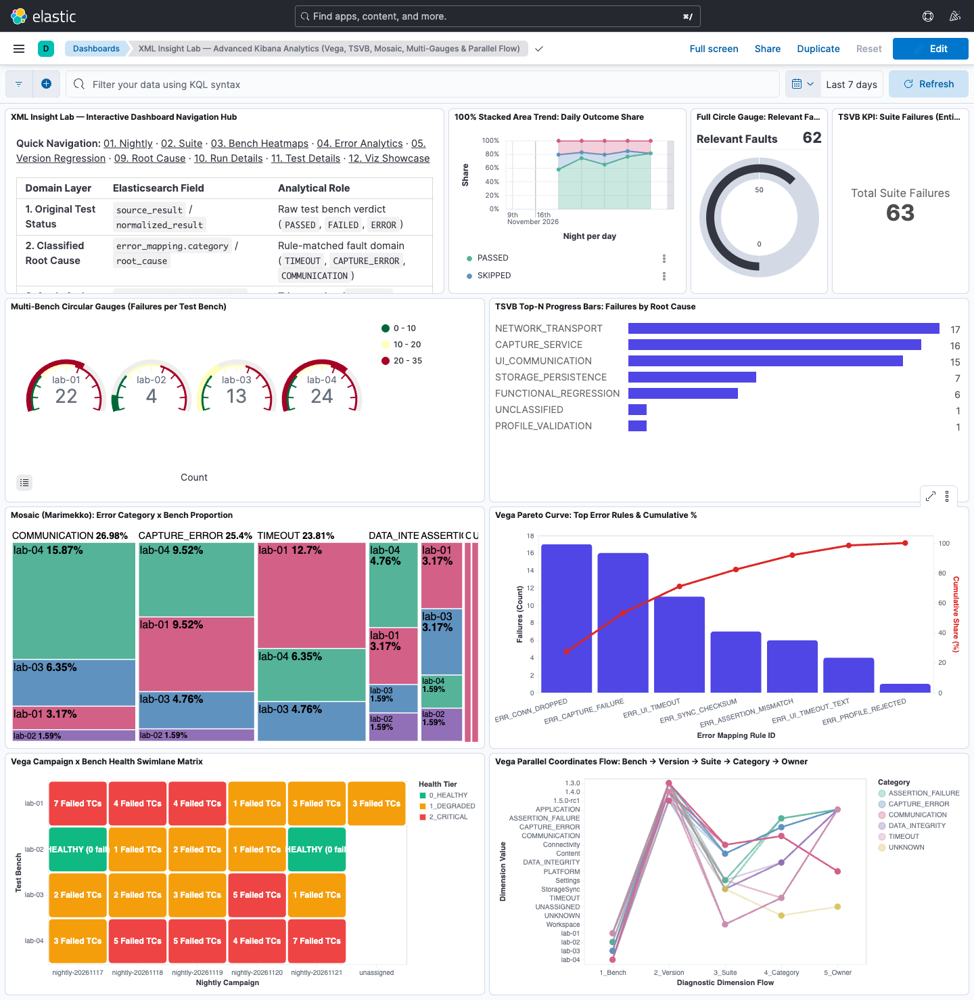
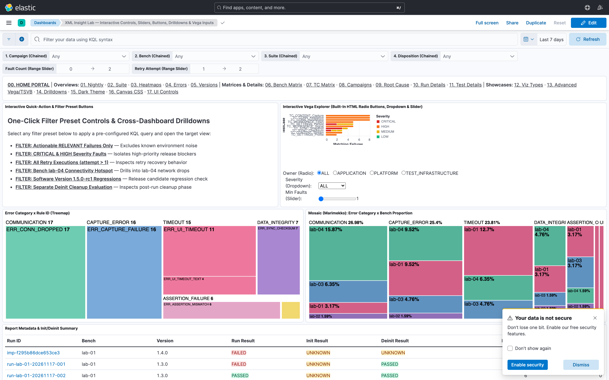
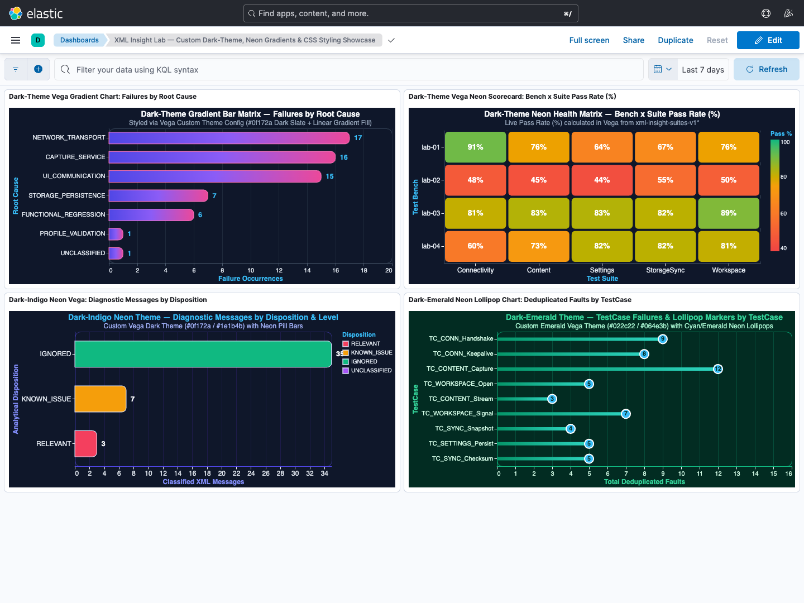
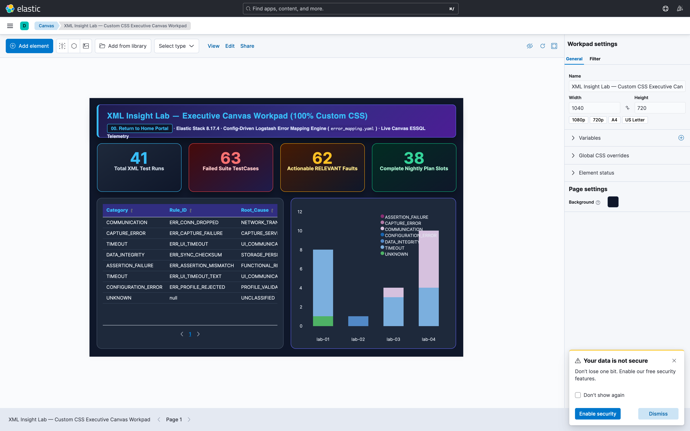
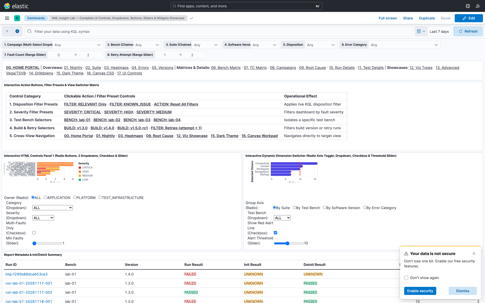
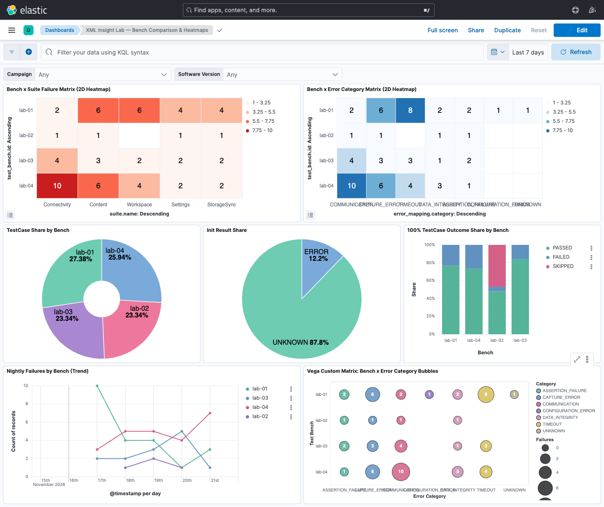

# XML Insight Lab — Project Showcase

**XML Insight Lab** is a fully containerized Elastic Stack (`8.17.4`) analytics platform implemented in `project/`for ingesting, validating, normalizing, classifying, and visualizing `<report>`XML test execution reports across multiple test benches (`lab-01`–`lab-04`), suites (`Workspace`, `Content`, `Settings`, `Connectivity`, `StorageSync`), software versions (`1.3.0`, `1.4.0`, `1.5.0-rc1`), and nightly campaigns.

> **Deep Dive Documentation:** See **[Section 5: Logstash Deep Dive, XML Pipelines & Error Mapping](sections/05-logstash-pipelines-and-xml-normalization/index.html)** for a complete chapter-by-chapter technical guide covering `xml-insight.conf`, `normalize_report.rb`, `error_mapping.yaml`, deterministic SHA-256 routing, and Kibana visualization customization.

---

## Kibana Visualization & Interactivity Capabilities Matrix (28 Distinct Capabilities)

To demonstrate the full visual analytics and interactive UI power of Kibana `8.17.4`, our 14 provisioned dashboards combine **28 distinct visualization & interactive control paradigms** across **Kibana Lens**, **Interactive Controls (`controlGroupInput`)**, **Dynamic Drilldowns (`dynamicActions`)**, **Data View Field Formatters (`fieldFormatMap`)**, **TSVB (Time Series Visual Builder)**, **Classic Aggregation Visualizations**, **Markdown Navigation Hubs**, and **Vega-Lite Custom Grammar with HTML Inputs**:

| # | Kibana Visualization / Interactive Control Type | Technical Type (`visualizationType`/ `visState.type`) | Where It Is Used in Our Dashboards |
| :--- | :--- | :--- | :--- |
| **1** | **KPI Metric Card** | `lens`→ `lnsMetric`| Top KPI summary rows across Dashboards `01`, `02`, `05`, `09`, `10`, `11`, `12`|
| **2** | **Arc Gauge (Semicircular Dial)** | `lens`→ `lnsGauge`(`shape: "arc"`) | `Complete Plan Slots (38 / 40)`on Dashboard `12`|
| **3** | **Horizontal Bullet Gauge** | `lens`→ `lnsGauge`(`shape: "horizontalBullet"`) | `Received Plan Reports (39 / 40)`on Dashboard `12`|
| **4** | **Full 360° Circle Ring Gauge** | `lens`→ `lnsGauge`(`shape: "circle"`) | `Relevant Faults (62)`on Dashboard `13`|
| **5** | **Multi-Bucket Circular Gauges (4-in-1 Panel)** | `visualization`→ `gauge`(`group`split by `test_bench.id`) | `Failures per Test Bench (lab-01..lab-04)`on Dashboards `08`, `13`|
| **6** | **Hierarchical Treemap** | `lens`→ `lnsPie`(`shape: "treemap"`) | `Error Category × Rule ID`(Dashboards `04`, `12`, `14`) & `Owner × Root Cause`(Dashboard `09`) |
| **7** | **Mosaic / Marimekko 2D Proportional Chart** | `lens`→ `lnsPie`(`shape: "mosaic"`) | `Error Category × Bench Proportion`on Dashboards `13`, `14`|
| **8** | **Waffle Grid Chart (10×10 Tile Grid)** | `lens`→ `lnsPie`(`shape: "waffle"`) | `Diagnostic Message Disposition`(Dashboards `09`, `12`) & `Failure Share by Software Version`(Dashboard `05`) |
| **9** | **Multi-Ring Sunburst (2-Level Concentric Donut)** | `lens`→ `lnsPie`(`shape: "donut"`, 2 rings) | `Bench → Suite Failure Sunburst`(Dashboards `06`, `12`) |
| **10** | **1-Ring Donut Chart** | `lens`→ `lnsPie`(`shape: "donut"`) | `Disposition Share`, `Owner Share`, `Plan Completeness Share`|
| **11** | **Classic Pie Chart** | `lens`→ `lnsPie`(`shape: "pie"`) | `Init Result Share`(`03`) & `Error Trend NEW/RECURRING/FIXED`(`04`) |
| **12** | **Vertical Stacked Bar Chart** | `lens`→ `lnsXY`(`bar_stacked`) | Bench results, Version × Suite, Root Cause × Severity across Dashboards `01`, `02`, `05`, `09`|
| **13** | **Horizontal Bar Chart** | `lens`→ `lnsXY`(`bar_horizontal`) | Top Extracted Error Codes (`02`, `04`), Data Quality Flags (`05`), Matched Rule IDs (`09`) |
| **14** | **100% Percentage Stacked Bar (Vertical & Horizontal)** | `lens`→ `lnsXY`(`bar_percentage_stacked`, `bar_horizontal_percentage_stacked`) | `100% TestCase Outcome Share by Bench`(`03`, `12`) & `by Suite`(`02`) |
| **15** | **100% Percentage Stacked Area Trend** | `lens`→ `lnsXY`(`area_percentage_stacked`) | `Daily TestCase Outcome Share Trend (0–100%)`on Dashboard `13`|
| **16** | **Dual-Axis Combo Chart (Bars + Line)** | `lens`→ `lnsXY`(`bar`+ `line`overlay) | `Total Executions (Bars) vs. Failures (Line) by Suite`(Dashboards `02`, `12`) |
| **17** | **Stacked Area & Multi-Series Line Trend** | `lens`→ `lnsXY`(`area_stacked`, `line`) | Nightly TestCase status trends (`01`), Error trends (`02`), and Bench failure trends (`03`) |
| **18** | **TSVB Top-N Color Progress Bars & TSVB KPI** | `visualization`→ `metrics`(`type: "top_n"`& `type: "metric"`) | `Failures by Root Cause Progress Bars`& `Suite Failures KPI`on Dashboard `13`|
| **19** | **Tag Cloud (Word Cloud)** | `visualization`→ `tagcloud`| `Matched Error Rules`(Dashboards `04`, `12`) & `Classified Root Causes`(Dashboard `09`) |
| **20** | **2D Color Heatmap Matrix** | `visualization`→ `heatmap`| `Bench × Suite Failures`(`03`, `12`), `Bench × Error Category`(`03`), `Software Version × TestCase`(`05`) |
| **21** | **Vega-Lite Custom Proportional Bubble Matrix** | `visualization`→ `vega`(`circle`+ `text`layers) | `Bench × Error Category Proportional Bubble Matrix`(`03`, `12`) |
| **22** | **Vega-Lite Pareto Curve, Swimlane Matrix & 5-D Parallel Coordinates** | `visualization`→ `vega`(dual-axis Pareto, health swimlane & multi-stage fold flow) | `Top Error Rules Pareto Curve`, `Campaign × Bench Health Swimlane`(`08`, `13`) & `5-D Parallel Coordinates Flow`(`13`) |
| **23** | **Aggregated Lens Data Tables (`lnsDatatable`)** | `lens`→ `lnsDatatable`(`customLabel: true`) | 29 clean aggregated data tables across all dashboards |
| **24** | **Chained Hierarchical Dropdown Controls** | `controlGroupInput`→ `optionsListControl`(`chainingSystem: "HIERARCHICAL"`) | Cascading filter bar (`1. Campaign → 2. Bench → 3. Suite → 4. Disposition`) across all dashboards |
| **25** | **Numeric Two-Handle Range Slider Controls** | `controlGroupInput`→ `rangeSliderControl`| Interactive numeric sliders for `Fault Count (0..2)`and `Retry Attempt (1..2)`on Dashboards `12`, `13`, `14`|
| **26** | **One-Click KQL Filter Preset & Navigation Buttons** | `visualization`→ `markdown`with KQL query URL parameters | One-click triage preset buttons (`RELEVANT Only`, `CRITICAL & HIGH`, `Retries > 1`, `lab-04 Hotspot`) on Dashboard `14`|
| **27** | **Dashboard-to-Dashboard Click Drilldowns & Data View Color/URL Formatters** | `enhancements.dynamicActions`(`DASHBOARD_TO_DASHBOARD_DRILLDOWN`) & `fieldFormatMap`(`color`, `url`) | Context drilldown buttons to Dashboards `09`/`10`/`11`, clickable `run.id`links, and Red/Green/Amber status pill badges in all tables |
| **28** | **Vega Built-In HTML Radio Buttons, Select Dropdown & Range Slider (`bind`)** | `visualization`→ `vega`(`params[].bind`: `radio`, `select`, `range`) | In-chart HTML Radio Buttons (`Owner`), Select Dropdown (`Severity`), and Range Slider (`Min Faults`) on Dashboard `14`|
| **29** | **Custom Dark-Theme & Linear-Gradient Vega Charts (Dark Slate `#0f172a`& Emerald `#022c22`)** | `visualization`→ `vega`(`background`, `config`, `gradient: "linear"`, Lollipop & Neon Pass-Rate Cards) | 4 dark-themed neon gradient visualizations on Dashboard `15`|
| **30** | **Kibana Canvas 16:9 Presentation Workpad with 100% Custom CSS (`render css="..."`) & Live ESSQL** | `canvas-workpad`(`/app/canvas#/workpad/workpad-xml-insight-executive`) | Full-HD dark-gradient executive slide with per-element CSS (`linear-gradient`, `box-shadow`, `border-radius`), 4 ESSQL KPI cards, styled SQL table & plot (`16`) |

---

## Complete Dashboard & Canvas Gallery (Home Portal + 15 Dashboards + 1 Custom CSS Canvas Workpad)

### 00. Central Home Portal & Interactive Dashboard Directory (`xml-insight-home`)
The central landing page and application launchpad (`/app/dashboards#/view/xml-insight-home`) for the entire XML Insight Lab suite. It displays live system health KPIs (`Total Runs`, `Failed TestCases`, `Actionable RELEVANT Faults`, `Active Error Rules`), four categorized interactive directory cards covering all **17 dashboards and Canvas workpads** (`Category A: Operational Overviews`, `Category B: Error Mapping & Regression`, `Category C: Aggregated Lens Matrices & Drilldowns`, `Category D: Kibana Visualization, Custom CSS, Canvas & UI Controls Showcases`), and two live Dark-Theme Vega preview matrices.
- **Bidirectional Round-Trip Navigation:** Clicking any link on the Home Portal opens the target dashboard, and **every single dashboard (`01`–`17`) features a persistent top `00. HOME PORTAL (All Dashboards)`navigation bar** so you can jump back to the Home Portal or switch between any view with one click.

---

### Featured I: 12. Kibana Visualization Capabilities Showcase (`xml-insight-viz-showcase`)
Our first flagship capability showcase displaying **12 distinct Kibana visualization types side by side**: KPI Metric (`lnsMetric`), Arc Gauge (`lnsGauge`), Horizontal Bullet Gauge (`lnsGauge`), Hierarchical Treemap (`lnsPie`), Waffle Grid (`lnsPie`), Multi-Ring Sunburst (`lnsPie`), 100% Percentage Stacked Bar (`lnsXY`), Dual-Axis Bar+Line Combo Chart (`lnsXY`), Tag Cloud (`tagcloud`), 2D Color Heatmap (`heatmap`), Vega-Lite Custom Bubble Matrix (`vega`), and an aggregated Lens Data Table (`lnsDatatable`).

---

### Featured II: 13. Advanced Kibana Analytics — Vega, TSVB, Mosaic, Multi-Gauges & Parallel Flow (`xml-insight-advanced-analytics`)
Our second flagship showcase demonstrating **10 additional advanced Kibana paradigms**:
1. **Interactive Markdown Navigation Hub (`markdown`)** with clickable cross-dashboard links and 3-layer domain table
2. **100% Percentage Stacked Area Trend (`area_percentage_stacked`)** of daily testcase outcome shares
3. **Full 360° Circle Ring Gauge (`lnsGauge`, `shape: "circle"`)** for actionable `RELEVANT`faults
4. **TSVB KPI Card (`metrics`, `type: "metric"`)** across the entire time range
5. **Multi-Bench Circular Gauges (`gauge`)** rendering 4 color-coded gauges (`lab-01`..`lab-04`) in a single panel
6. **TSVB Top-N Color Progress Bars (`metrics`, `type: "top_n"`)** ranking failures by `error_mapping.root_cause`
7. **Mosaic / Marimekko 2D Proportional Chart (`lnsPie`, `shape: "mosaic"`)** showing `Error Category × Bench`proportions
8. **Vega-Lite Dual-Axis Pareto Curve (`vega`)** combining rule failure bars with a cumulative `0–100%`line
9. **Vega-Lite Campaign × Bench Health Swimlane Matrix (`vega`)** coloring every nightly campaign slot as `HEALTHY`, `DEGRADED`, or `CRITICAL`
10. **Vega-Lite 5-Dimension Parallel Coordinates Flow (`vega`)** tracing failure paths across `1_Bench → 2_Version → 3_Suite → 4_Category → 5_Owner`

---

### Featured III: 14. Interactive Controls, Sliders, Buttons, Drilldowns & Vega Inputs (`xml-insight-interactive-showcase`)
Our third flagship showcase dedicated to **interactive UI controls, buttons, formatters, and drilldowns**:
1. **Chained Hierarchical Dropdowns (`optionsListControl`, `chainingSystem: "HIERARCHICAL"`)**: Selecting `1. Campaign`filters `2. Bench`, which filters `3. Suite`, which filters `4. Disposition`.
2. **Numeric Two-Handle Range Sliders (`rangeSliderControl`)**: Filter by `Fault Count (0 → 2)`and `Retry Attempt (1 → 2)`.
3. **One-Click KQL Filter Preset Buttons (`markdown`)**: Instant buttons applying pre-configured KQL filters (`Actionable RELEVANT Failures Only`, `CRITICAL & HIGH Severity Faults`, `All Retry Executions (attempt > 1)`, `Bench lab-04 Connectivity Hotspot`).
4. **Vega Explorer with Built-In HTML Radio Buttons, Select Dropdown & Range Slider (`bind`)**: Live in-chart HTML controls (`Owner (Radio)`, `Severity (Dropdown)`, `⊶ Min Faults (Slider)`).
5. **Dashboard-to-Dashboard Context Drilldowns (`DASHBOARD_TO_DASHBOARD_DRILLDOWN`)** and **Data View Color Badges & Clickable `run.id`Hyperlink Buttons (`fieldFormatMap`)**.

---

### Featured IV: 15. Custom Dark-Theme, Neon Gradients & CSS Styling Showcase (`xml-insight-custom-css-showcase`)
Demonstrates custom visual design inside standard Kibana Dashboards using **Vega Custom Theme Configurations (`"background": "#0f172a"`Dark Slate and `"#022c22"`Dark Emerald)**, multi-stop **SVG Linear Gradients (`#4f46e5 → #8b5cf6 → #ec4899`and `#059669 → #2dd4bf`)**, glowing **Neon Pass-Rate Scorecards (`Bench × Suite Pass %`)**, and **Multi-Layer Lollipop Charts (`bar`+ `circle`+ `text`)**:

---

### Featured V: 16. Kibana Canvas — 100% Custom CSS Executive Presentation Workpad (`workpad-xml-insight-executive`)
Beyond standard grid dashboards, Kibana's **Canvas App (`/app/canvas#/workpad/workpad-xml-insight-executive/page/1`)** enables pixel-accurate 16:9 presentation slides where **every single element is styled with real CSS (`| render css=".canvasRenderEl { background: linear-gradient(...); border-radius: 14px; box-shadow: ... }"`)** and powered by live **Canvas ESSQL (`SELECT ... FROM "xml-insight-*"`)** queries:

---

### Featured VI: 17. Complete UI Controls, Dropdowns, Buttons, Sliders & Widgets Gallery (`xml-insight-ui-controls-gallery`)
A dedicated **Interactive UI Controls & Form Widgets Showcase Dashboard** combining every interactive control pattern in Kibana on a single view:
- **8 Native Top-Bar Controls (`controlGroupInput`, 2 rows):**
 - `1. Campaign (Multi-Select Dropdown)`· `2. Bench (Single-Select Chained Dropdown)`· `3. Suite (Chained Dropdown)`· `4. Software Version`· `5. Disposition`· `6. Error Category`
 - `7. Fault Count (Numeric Two-Handle Range Slider: 0 → 2)`· `8. Retry Attempt (Numeric Two-Handle Range Slider: 1 → 2)`
- **5-Category Clickable Action & Filter Preset Button Matrix (`markdown`):**
 - **Disposition Filter Buttons:** `RELEVANT Only`· `KNOWN_ISSUE`· `Reset All Filters`
 - **Severity Filter Buttons:** `CRITICAL Only`· `HIGH Severity`· `MEDIUM Severity`
 - **Test Bench Buttons:** `Bench lab-01`· `Bench lab-02`· `Bench lab-03`· `Bench lab-04`
 - **Version & Retry Buttons:** `v1.3.0`· `v1.4.0`· `v1.5.0-rc1`· `Retries (attempt > 1)`
 - **Cross-View Navigation Buttons:** `01. Nightly`· `03. Heatmaps`· `09. Root Cause`· `12. Viz Showcase`· `15. Dark Theme`· `16. Canvas`
- **2 Interactive HTML Form Control Panels (`vega`with `params[].bind`):**
 - **Panel 1:** `Owner (Radio Buttons)`+ `Category (Dropdown)`+ `Severity (Dropdown)`+ `Multi-Faults Only (Checkbox)`+ `⊶ Min Faults (Range Slider)`
 - **Panel 2:** `Group Axis By (Dynamic Dimension Radio Switcher: By Suite / By Test Bench / By Software Version / By Error Category)`+ `Test Bench (Dropdown)`+ `Red Alert Line (Checkbox Toggle)`+ `⊶ Alert Threshold (Slider moving the dashed red cutoff line live)`
- **Interactive Table with Clickable `run.id`Hyperlink Buttons, Color Pill Badges (`FAILED`/`PASSED`/`UNKNOWN`), and Context Drilldown Menus (`DASHBOARD_TO_DASHBOARD_DRILLDOWN`)**

---

### 1. Nightly Overview (`xml-insight-nightly-overview`)
Tracks planned vs. received vs. missing vs. partial vs. invalid reports, bench-level result distribution, `init`/`deinit`anomalies, daily failure categories, stacked area trends, and three aggregated **Lens Data Tables (`lnsDatatable`)** for Plan Status, Dynamic Failures & Errors, and Malformed/Rejected XML Import Errors.

---

### 2. Suite Overview (`xml-insight-suite-overview`)
Compares suite execution outcomes across test benches, regular `testCase`results (`phase: "suite"`, excluding `deinit`), `NEW`/ `RECURRING`/ `FIXED`error trends, software version distribution, top extracted error codes, an aggregated `lnsDatatable`of failed suites, a **Dual-Axis Combo Chart (`Total Executions vs. Failures by Suite`)**, and a **100% Horizontal Percentage Stacked Bar (`100% TestCase Outcome Share by Suite`)**.

---

### 3. Bench Comparison & Heatmaps (`xml-insight-bench-comparison`)
Combines **two 2D Color Heatmaps (`Bench × Suite Failure Matrix`and `Bench × Error Category Matrix`)**, a **100% Percentage Stacked Bar (`100% TestCase Outcome Share by Bench`)**, Donut/Pie shares, a multi-series daily failure line chart, and a custom **Vega-Lite Proportional Bubble Matrix (`Bench × Error Category Bubbles`)**.

---

### 4. Error & Retry Analytics (`xml-insight-error-analytics`)
Breaks down failures by `error_mapping.category`(Donut), `error_trend`(`NEW`/ `RECURRING`/ `FIXED`Pie), diagnostic message `level`(Donut), horizontal error code frequency, retry recovery (`attempt > 1`), an aggregated `lnsDatatable`of dynamic testCase failures, a **Hierarchical Treemap (`Error Category × Rule ID`)**, and a **Tag Cloud (`Matched Error Rules`)**.

---

### 5. Software Version & Regression Lab (`xml-insight-version-regression`)
Highlights regressions across software builds (`1.3.0`→ `1.4.0`→ `1.5.0-rc1`) with 4 KPI cards, stacked bar breakdowns by Suite, Error Category, and TestCase, two aggregated `lnsDatatable`summaries (`Version Health Summary`and `Version x Error Rule Breakdown`), plan suite completeness, data quality flags, a **2D Color Heatmap (`Software Version × TestCase Failures`)**, and a **Waffle Grid (`Failure Share by Software Version`)**.

---

### 6. Bench & Suite Failure Matrix (`xml-insight-bench-suite-matrix`)
Uses aggregated **Lens Data Tables (`lnsDatatable`)** and a nested Bench → Suite multi-ring sunburst donut to summarize total testCase counts, failure counts, and error category breakdowns across every `test_bench.id`× `suite.name`combination.

---

### 7. TestCase & Error Matrix (`xml-insight-testcase-matrix`)
Provides four grouped `lnsDatatable`matrices covering Software Version × TestCase regressions, top extracted error codes by Bench and TestCase, retry attempt outcomes (`attempt > 1`), and message origin/level distributions (`group_msg`, `step_msg`, `errors_block`).

---

### 8. Campaign & Bench Health Matrix (`xml-insight-campaign-matrix`)
Aggregates multi-night campaign health across four `lnsDatatable`views: Campaign × Bench run outcomes, nightly plan completeness (`COMPLETE`, `PARTIAL`, `NONE`, `MISSING`), suite execution summaries, and XML import validation errors.

---

### 9. Error Classification & Root Cause Analysis (`xml-insight-error-classification`)
Dedicated dashboard for the config-driven Error Mapping Engine (`error_mapping.yaml`), featuring 4 KPI cards (`Relevant Failures`, `Known Issues`, `Investigate Faults`, `Ignored Warnings`), breakdowns by `category`, `disposition`, `severity`, `root_cause`, and `owner`, two aggregated `lnsDatatable`views, plus an **Owner × Root Cause Hierarchical Treemap**, a **Diagnostic Message Disposition Waffle Grid**, and a **Classified Root Causes Tag Cloud**.

---

### 10. Run Details (`xml-insight-run-details`)
Focused drilldown view for run-level inspection, combining 4 KPI metrics (`Total Runs`, `Failed Runs`, `Suites Executed`, `Deinit Failures`) with three clean `lnsDatatable`panels: **Report Metadata & Init/Deinit Summary**, **Suites in Report**, and **Separate Deinit Evaluation** (`phase: "deinit"`).

---

### 11. Test Details (`xml-insight-test-details`)
Step- and message-level diagnostic view with 4 KPI metrics (`Total Steps`, `Failed Steps`, `Error Messages`, `Mapped Error Rules`) and three clean `lnsDatatable`panels: **Step Results by TestCase & Step**, **Failed Steps & Error Mapping** (`Category`, `Rule ID`), and **Messages & Explicit `<errors>`Entries** (`Phase`, `Origin`, `Level`, `Category`, `Message`, `Occurrences`).

---

## Official References & Further Reading

- [Kibana Guide — Create Visualizations with Lens (`lnsDatatable`, `lnsXY`, `lnsPie`, `lnsGauge`, `lnsMetric`)](https://www.elastic.co/guide/en/kibana/current/lens.html)
- [Kibana Guide — Vega & Vega-Lite Custom Visualizations in Kibana](https://www.elastic.co/guide/en/kibana/current/vega.html)
- [Logstash Reference — XML Filter Plugin (`store_xml`, `remove_namespaces`)](https://www.elastic.co/guide/en/logstash/current/plugins-filters-xml.html)
- [Logstash Reference — Ruby Filter Plugin (`register`, `filter`, `script_params`)](https://www.elastic.co/guide/en/logstash/current/plugins-filters-ruby.html)
