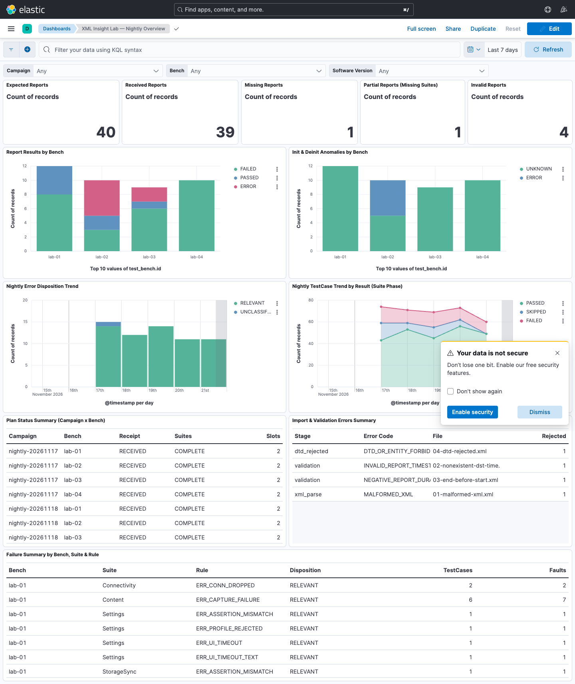
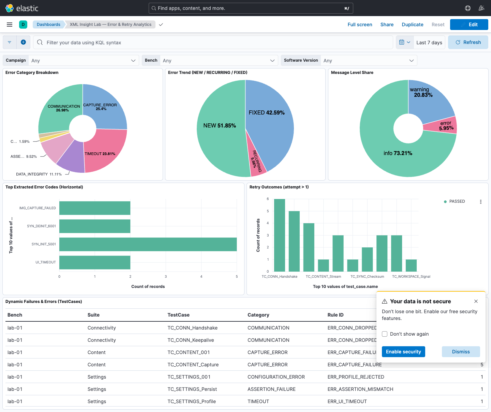
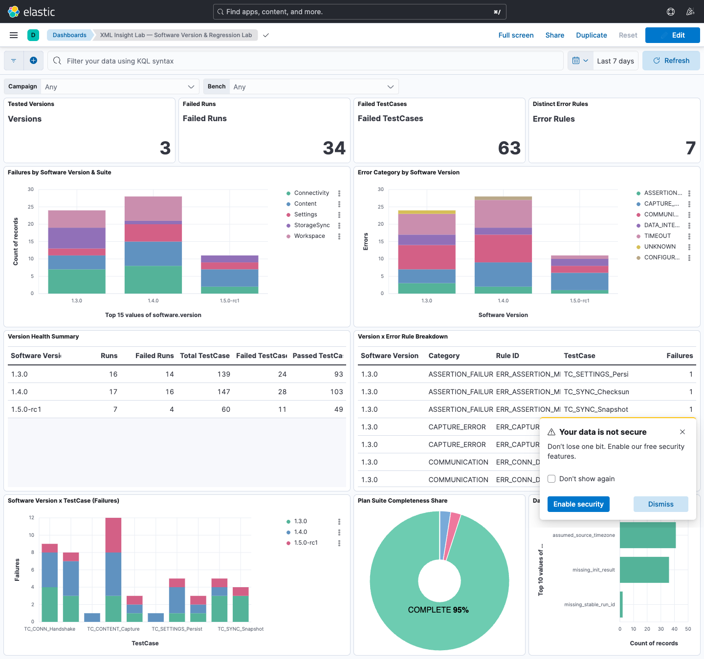
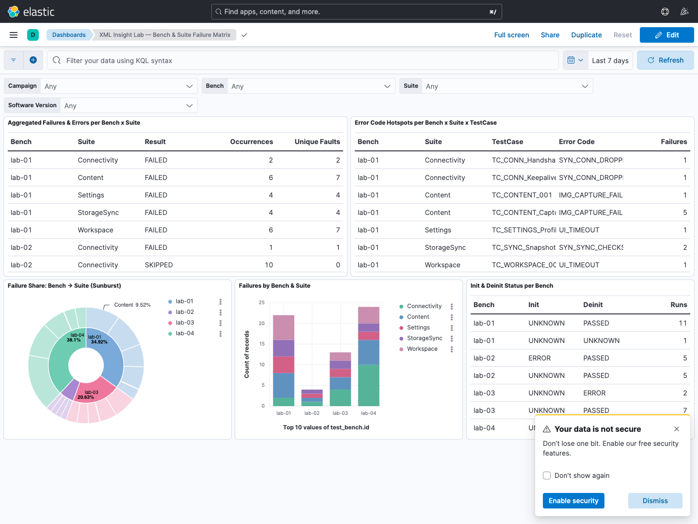
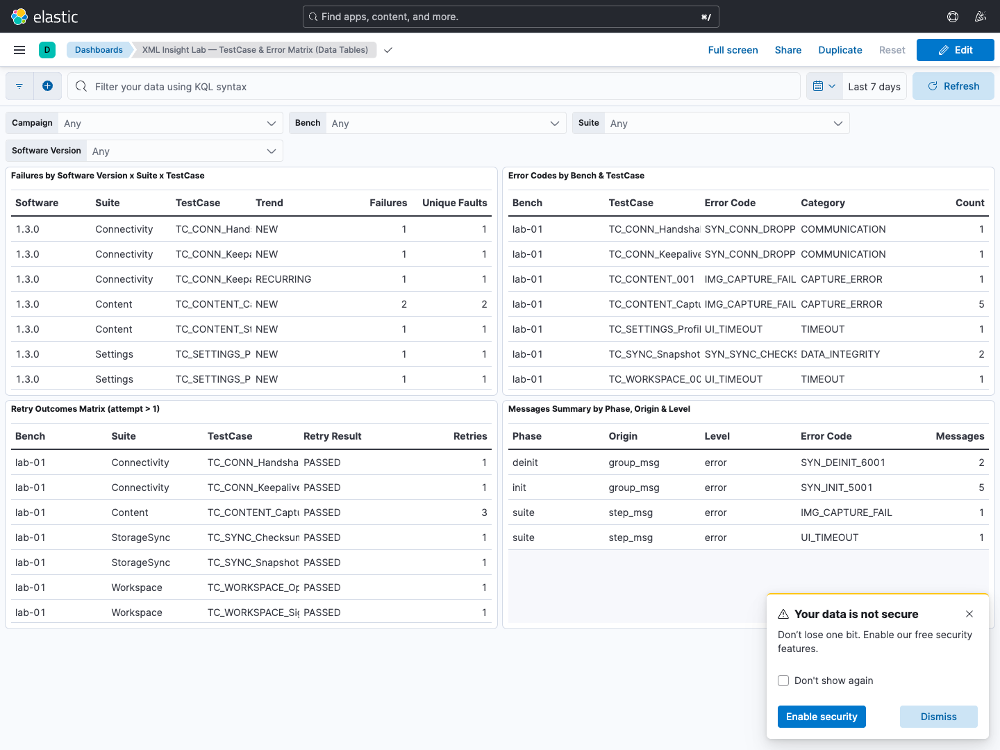
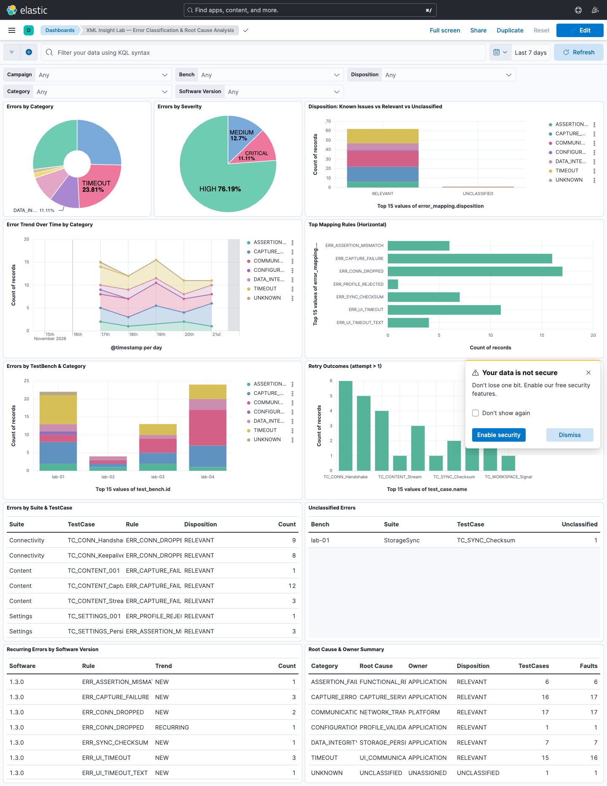
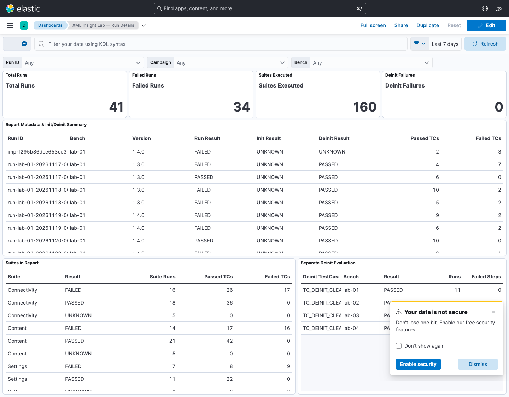
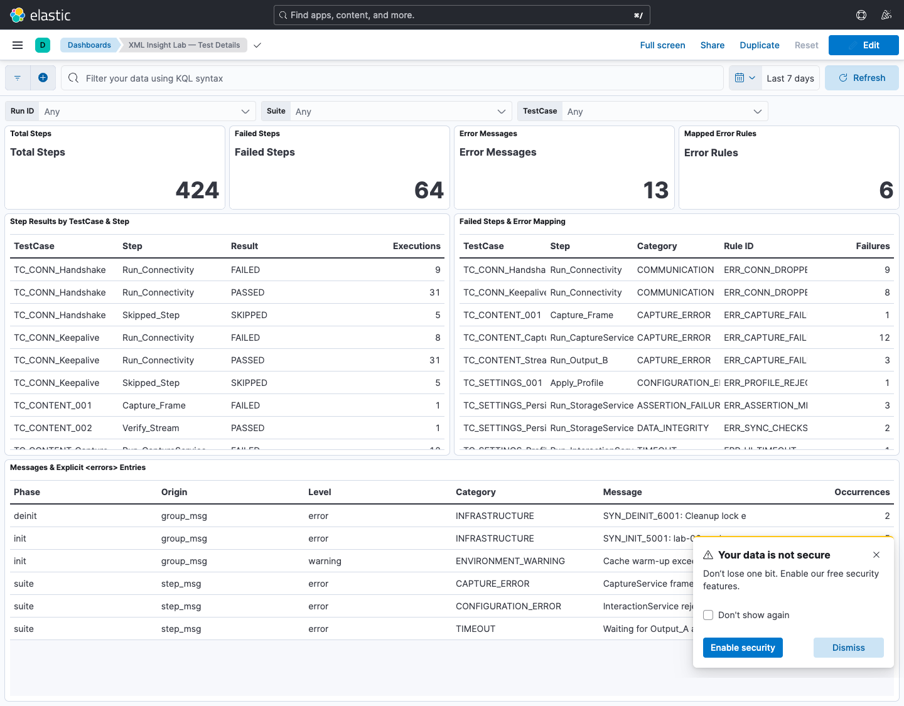

# XML Insight Lab — Project Showcase

**XML Insight Lab** is a fully containerized Elastic Stack (`8.17.4`) analytics platform implemented in `project/` for ingesting, validating, normalizing, classifying, and visualizing `<report>` XML test execution reports across multiple test benches (`lab-01`–`lab-04`), suites (`Workspace`, `Content`, `Settings`, `Connectivity`, `StorageSync`), software versions (`1.3.0`, `1.4.0`, `1.5.0-rc1`), and nightly campaigns.

> **Deep Dive Documentation:** See **[Section 5: Logstash Deep Dive, XML Pipelines & Error Mapping](sections/05-logstash-pipelines-and-xml-normalization/index.html)** for a complete chapter-by-chapter technical guide covering `xml-insight.conf`, `normalize_report.rb`, `error_mapping.yaml`, deterministic SHA-256 routing, and Kibana `lnsDatatable` customization.

## Architecture, Logstash Pipeline & Error Mapping Engine

- **Ingestion (`tools/xml_insight_lab/ingester.py`):** Reads complete XML files, computes SHA-256 file hashes (`file_sha256`), strips local paths, and sends JSON envelopes to the Logstash HTTP input (`:8080`).
- **Logstash Pipeline (`project/logstash/pipeline/xml-insight.conf`):**
  1. **Security Pre-Checks:** Rejects missing payloads and DTD/XXE declarations (`<!DOCTYPE` / `<!ENTITY`) before parsing.
  2. **Official `xml` Filter:** Parses `raw_xml` into `parsed_xml` (`remove_namespaces => true`).
  3. **Stateless Ruby Normalizer (`normalize_report.rb`):** Converts timestamps to UTC, preserves `source_result` alongside `normalized_result`, separates regular functional suites (`phase: "suite"`) from cleanup (`phase: "deinit"`), and fans out 1 XML report into N typed documents with deterministic SHA-256 `[@metadata][doc_id]` primary keys.
- **Config-Driven Error Mapping Engine (`project/config/error_mapping.yaml` & `error_mapping.rb`):**
  - Evaluates `error_code`, `regex`, `contains`, and `exact` rules with numeric priorities, deterministic tie-breaking, and optional scope restrictions (`phase`, `suite`, `test_case`, `component`).
  - Enforces a clean three-way separation between **Original Test Status (`normalized_result`)**, **Classified Failure Cause (`error_mapping.category`, `error_mapping.root_cause`)**, and **Analytical Disposition (`error_mapping.disposition`: `RELEVANT`, `KNOWN_ISSUE`, `INVESTIGATE`, `IGNORED`)**.
- **Elasticsearch (7 strict index families):** `xml-insight-runs-v1`, `xml-insight-suites-v1`, `xml-insight-testcases-v1`, `xml-insight-steps-v1`, `xml-insight-messages-v1`, `xml-insight-errors-v1`, and `xml-insight-plan-status-v1`.
- **Kibana Lens Dashboards (`xml-insight-dashboard.ndjson`):** 11 dashboards (81 panels total) using aggregated **Lens Data Tables (`lnsDatatable`)** with custom column headers (`customLabel: true`), KPI cards (`lnsMetric`), stacked bar charts (`lnsXY`), and donut charts (`lnsPie`) focused exclusively on failures, test benches, suites, software versions, and root-cause analysis.

---

## Complete Dashboard Gallery (All 11 Dashboards)

### 1. Nightly Overview (`xml-insight-nightly-overview`)
Tracks planned vs. received vs. missing vs. partial vs. invalid reports, bench-level result distribution, `init`/`deinit` anomalies, daily failure categories, and three aggregated **Lens Data Tables (`lnsDatatable`)** for Plan Status, Dynamic Failures & Errors, and Malformed/Rejected XML Import Errors.

---

### 2. Suite Overview (`xml-insight-suite-overview`)
Compares suite execution outcomes across test benches, regular `testCase` results (`phase: "suite"`, excluding `deinit`), `NEW` / `RECURRING` / `FIXED` error trends, software version distribution, top extracted error codes (`UI_TIMEOUT`, `IMG_CAPTURE_FAILED`, `SYN_CONN_DROPPED`), and an aggregated `lnsDatatable` of failed suites.

---

### 3. Bench Comparison (`xml-insight-bench-comparison`)
Uses stacked bar charts (`lnsXY`), donut/pie shares (`lnsPie`), and daily bench failure trends to surface cross-bench failure hotspots (such as `lab-04` Connectivity failures and `lab-02` Initialization errors) for both `RELEVANT` failures and all failures/errors.

---

### 4. Error & Retry Analytics (`xml-insight-error-analytics`)
Breaks down failures by `error_mapping.category`, `error_trend` (`NEW` / `RECURRING` / `FIXED`), diagnostic message `level` (`info` / `warning` / `error`), horizontal error code frequency, retry recovery (`attempt > 1`), and an aggregated `lnsDatatable` of dynamic testCase failures by bench, suite, category, and rule ID.

---

### 5. Software Version & Regression Lab (`xml-insight-version-regression`)
Highlights regressions across software builds (`1.3.0` → `1.4.0` → `1.5.0-rc1`) with 4 KPI cards (`Tested Versions`, `Failed Runs`, `Failed TestCases`, `Distinct Error Rules`), stacked bar breakdowns by Suite, Error Category, and TestCase, two aggregated `lnsDatatable` summaries (`Version Health Summary` and `Version x Error Rule Breakdown`), plan suite completeness, and data quality flags.

---

### 6. Bench & Suite Failure Matrix (`xml-insight-bench-suite-matrix`)
Uses aggregated **Lens Data Tables (`lnsDatatable`)** and a nested Bench → Suite sunburst donut to summarize total testCase counts, failure counts, and error category breakdowns across every `test_bench.id` × `suite.name` combination.

---

### 7. TestCase & Error Matrix (`xml-insight-testcase-matrix`)
Provides four grouped `lnsDatatable` matrices covering Software Version × TestCase regressions, top extracted error codes by Bench and TestCase, retry attempt outcomes (`attempt > 1`), and message origin/level distributions (`group_msg`, `step_msg`, `errors_block`).

---

### 8. Campaign & Bench Health Matrix (`xml-insight-campaign-matrix`)
Aggregates multi-night campaign health across four `lnsDatatable` views: Campaign × Bench run outcomes, nightly plan completeness (`COMPLETE`, `PARTIAL`, `NONE`, `MISSING`), suite execution summaries, and XML import validation errors.

---

### 9. Error Classification & Root Cause Analysis (`xml-insight-error-classification`)
Dedicated dashboard for the config-driven Error Mapping Engine (`error_mapping.yaml`), featuring 4 KPI cards (`Relevant Failures`, `Known Issues`, `Investigate Faults`, `Ignored Warnings`), breakdowns by `category`, `disposition`, `severity`, `root_cause`, and `owner`, plus two aggregated `lnsDatatable` views for rule hit summaries and diagnostic message classification.

---

### 10. Run Details (`xml-insight-run-details`)
Focused drilldown view for run-level inspection, combining 4 KPI metrics (`Total Runs`, `Failed Runs`, `Suites Executed`, `Deinit Failures`) with three clean `lnsDatatable` panels: **Report Metadata & Init/Deinit Summary**, **Suites in Report**, and **Separate Deinit Evaluation** (`phase: "deinit"`).

---

### 11. Test Details (`xml-insight-test-details`)
Step- and message-level diagnostic view with 4 KPI metrics (`Total Steps`, `Failed Steps`, `Error Messages`, `Mapped Error Rules`) and three clean `lnsDatatable` panels: **Step Results by TestCase & Step**, **Failed Steps & Error Mapping** (`Category`, `Rule ID`), and **Messages & Explicit `<errors>` Entries** (`Phase`, `Origin`, `Level`, `Category`, `Message`, `Occurrences`).

---

## Official References & Further Reading

- [Logstash Reference — XML Filter Plugin (`store_xml`, `remove_namespaces`)](https://www.elastic.co/guide/en/logstash/current/plugins-filters-xml.html)
- [Logstash Reference — Ruby Filter Plugin (`register`, `filter`, `script_params`)](https://www.elastic.co/guide/en/logstash/current/plugins-filters-ruby.html)
- [Elasticsearch Guide — Explicit & Strict Mappings (`dynamic: strict`)](https://www.elastic.co/guide/en/elasticsearch/reference/current/dynamic-field-mapping.html)
- [Kibana Guide — Create Visualizations with Lens (`lnsDatatable`, `lnsXY`, `lnsMetric`)](https://www.elastic.co/guide/en/kibana/current/lens.html)
