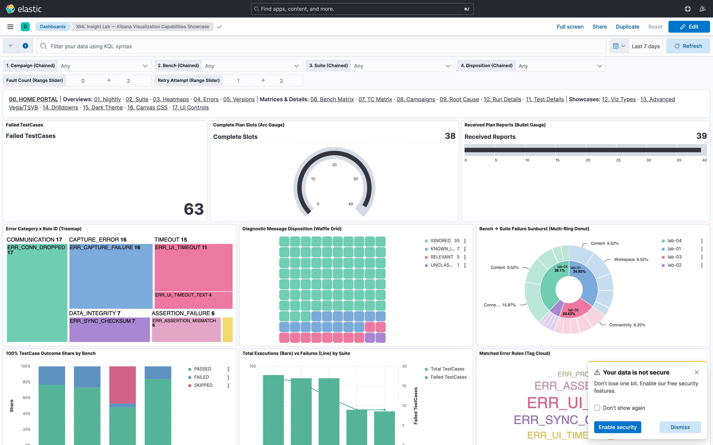
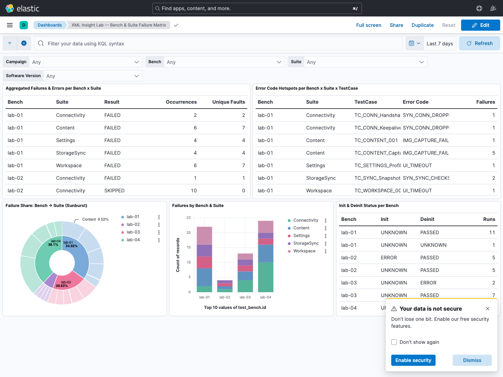

# XML Insight Lab

A locally runnable **Elasticsearch, Logstash, and Kibana** (`8.17.4`) analysis platform for synthetic `<report>`XML execution reports across multiple test benches, suites, software versions, and nightly campaigns.

> **Public & Synthetic Context Notice:** All projects (`SampleProject`), benches (`lab-01`–`lab-04`), suites (`Workspace`, `Content`, `Settings`, `Connectivity`, `StorageSync`), components (`Output_A`, `Output_B`, `CaptureService`, `InteractionService`, `StorageService`, `Connectivity`), and messages are 100% synthetic.

## Quickstart (Clean Setup)

From `/Users/cc/Desktop/ELK-Stack/project`:

```bash
./scripts/reset.sh --yes
./scripts/demo.sh
./scripts/verify.sh
```

- **Elasticsearch:** `http://127.0.0.1:9200`
- **Kibana Central Home Portal (Start Here):** `http://127.0.0.1:5601/app/dashboards#/view/xml-insight-home`
- **All Kibana Dashboards List:** `http://127.0.0.1:5601/app/dashboards#/list?_g=(filters:!(),refreshInterval:(pause:!t,value:1000),time:(from:now-7d,to:now))`

> **Local Development Security Note:** Host ports bind exclusively to `127.0.0.1`and `xpack.security.enabled=false`is configured solely for local single-node development.

## Operational Commands

| Command | Purpose |
| --- | --- |
| `./scripts/demo.sh`| Build tools, start ELK, install templates, generate 5 nights × 4 benches × 5 suites, ingest, reconcile, provision 12 Kibana dashboards, verify |
| `./scripts/reprocess.sh`| Reload `config/error_mapping.yaml`in Logstash, reset indices, and re-classify all XML reports without duplicates |
| `./scripts/status.sh`| Container status, ES health, and document counts across all 7 index families |
| `./scripts/verify.sh`| Run Logstash Ruby unit tests (`test_error_mapping.rb`), verify ES document counts, and run the full `pytest`suite |
| `./scripts/stop.sh`| Stop containers while preserving `esdata`volume |
| `./scripts/reset.sh`| **Destructive:** remove containers, `esdata`volume, and `./data/`|

## Dashboard Screenshots (Home Portal + 15 Dashboards + 1 Custom CSS Canvas Workpad)

### 00. Central Home Portal & Interactive Dashboard Directory (`xml-insight-home`)
Central landing page (`/app/dashboards#/view/xml-insight-home`) linking to all 17 dashboards and Canvas workpads by category, with live KPIs and Dark-Theme Vega preview charts. Every dashboard (`01`–`17`) includes a persistent top **`00. HOME PORTAL (All Dashboards)`** navigation bar to return here with one click.


### Featured I: 12. Kibana Visualization Capabilities Showcase
Demonstrates 12 distinct Kibana visualization types side by side: KPI Metric (`lnsMetric`), Arc Gauge (`lnsGauge`), Horizontal Bullet Gauge (`lnsGauge`), Hierarchical Treemap (`lnsPie`), Waffle Grid (`lnsPie`), Multi-Ring Sunburst (`lnsPie`), 100% Percentage Stacked Bar (`lnsXY`), Dual-Axis Bar+Line Combo Chart (`lnsXY`), Tag Cloud (`tagcloud`), 2D Color Heatmap (`heatmap`), Vega-Lite Custom Bubble Matrix (`vega`), and Aggregated Lens Data Table (`lnsDatatable`).


### Featured II: 13. Advanced Kibana Analytics (Vega, TSVB, Mosaic, Multi-Gauges & Parallel Flow)
Demonstrates 10 additional advanced Kibana paradigms: Interactive Markdown Navigation Hub (`markdown`), 100% Percentage Stacked Area Trend (`area_percentage_stacked`), Full 360° Circle Ring Gauge (`lnsGauge`), TSVB KPI (`metrics`), Multi-Bench 4-in-1 Circular Gauges (`gauge`), TSVB Top-N Color Progress Bars (`top_n`), Mosaic / Marimekko 2D Proportional Chart (`mosaic`), Vega-Lite Dual-Axis Pareto Curve (`vega`), Vega-Lite Campaign × Bench Health Swimlane Matrix (`vega`), and Vega-Lite 5-Dimension Parallel Coordinates Flow (`vega`).


### Featured III: 14. Interactive Controls, Sliders, Buttons, Drilldowns & Vega Inputs
Demonstrates Chained Hierarchical Dropdowns (`1. Campaign → 2. Bench → 3. Suite → 4. Disposition`), Numeric Range Sliders (`Fault Count`, `Retry Attempt`), One-Click KQL Filter Preset Buttons, Vega Built-In HTML Radio Buttons / Select Dropdown / Range Slider (`bind`), Dashboard-to-Dashboard Context Drilldowns (`DASHBOARD_TO_DASHBOARD_DRILLDOWN`), and Data View Color Badges & Clickable `run.id`Hyperlink Buttons (`fieldFormatMap`).


### Featured IV: 15. Custom Dark-Theme, Neon Gradients & CSS Styling Showcase
Demonstrates custom Dark-Slate (`#0f172a`) and Dark-Emerald (`#022c22`) Vega themes, multi-stop linear gradient bar fills (`#4f46e5 → #8b5cf6 → #ec4899`), glowing pass-rate scorecards (`Bench × Suite Pass %`), and neon lollipop markers.


### Featured V: 16. Kibana Canvas — 100% Custom CSS Executive Presentation Workpad (`/app/canvas`)
Pixel-accurate 16:9 presentation workpad (`workpad-xml-insight-executive`) where every element is styled with custom CSS (`render css=".canvasRenderEl { background: linear-gradient(...); border-radius: 14px; box-shadow: ... }"`) and populated via live **Canvas ESSQL (`SELECT ... FROM "xml-insight-*"`)** queries.


### Featured VI: 17. Complete UI Controls, Dropdowns, Buttons, Sliders & Widgets Gallery
Dedicated interactive UI controls showcase (`/app/dashboards#/view/xml-insight-ui-controls-gallery`) featuring 6 Chained Multi/Single-Select Dropdowns, 2 Numeric Two-Handle Range Sliders, a 5-Row Clickable Action & Filter Preset Button Matrix, 2 Vega HTML Form Control Explorers (Radio Button Groups, Dynamic Dimension Axis Switcher, Select Dropdowns, Checkbox Toggles, and Live Threshold Sliders), Clickable `run.id`Hyperlink Buttons, Color Badges, and Context Drilldown Menus.


### 01. Nightly Overview


### 02. Suite Overview


### 03. Bench Comparison & Heatmaps


### 04. Error & Retry Analytics


### 05. Software Version & Regression Lab


### 06. Bench & Suite Failure Matrix (Aggregated Lens Data Tables)


### 07. TestCase & Error Matrix (Aggregated Lens Data Tables)


### 08. Campaign & Bench Health Matrix (Aggregated Lens Data Tables)


### 09. Error Classification & Root Cause Analysis


### 10. Run Details


### 11. Test Details


## Documentation

- [`docs/architecture-and-data-modeling.md`](docs/architecture-and-data-modeling.md) — System architecture, data flow, and Elasticsearch data modeling
- [`docs/error-mapping.md`](docs/error-mapping.md) — Configurable error-mapping engine, rule priorities, and dispositions
- [`docs/kibana-dashboards-and-customization.md`](docs/kibana-dashboards-and-customization.md) — Official Kibana terminology (`lnsDatatable`vs. `Saved Search`), field cheat sheet, and UI/NDJSON customization guide
- [`docs/xml-format-v1.md`](docs/xml-format-v1.md) · [`schemas/execution-report-v1.xsd`](schemas/execution-report-v1.xsd) · [`examples/sample-report-v1.xml`](examples/sample-report-v1.xml)
- [`docs/elasticsearch-model.md`](docs/elasticsearch-model.md)
- [`docs/kibana-discover-guide.md`](docs/kibana-discover-guide.md)
- [`docs/extending-xml-formats.md`](docs/extending-xml-formats.md)
