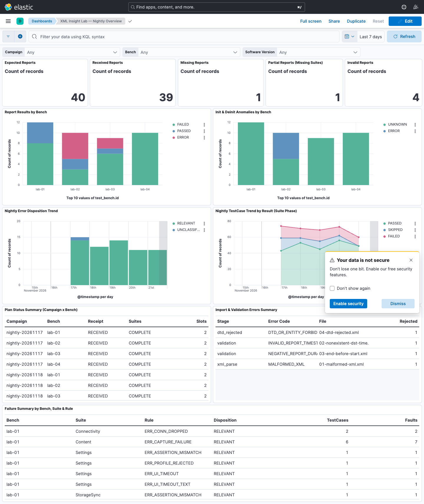
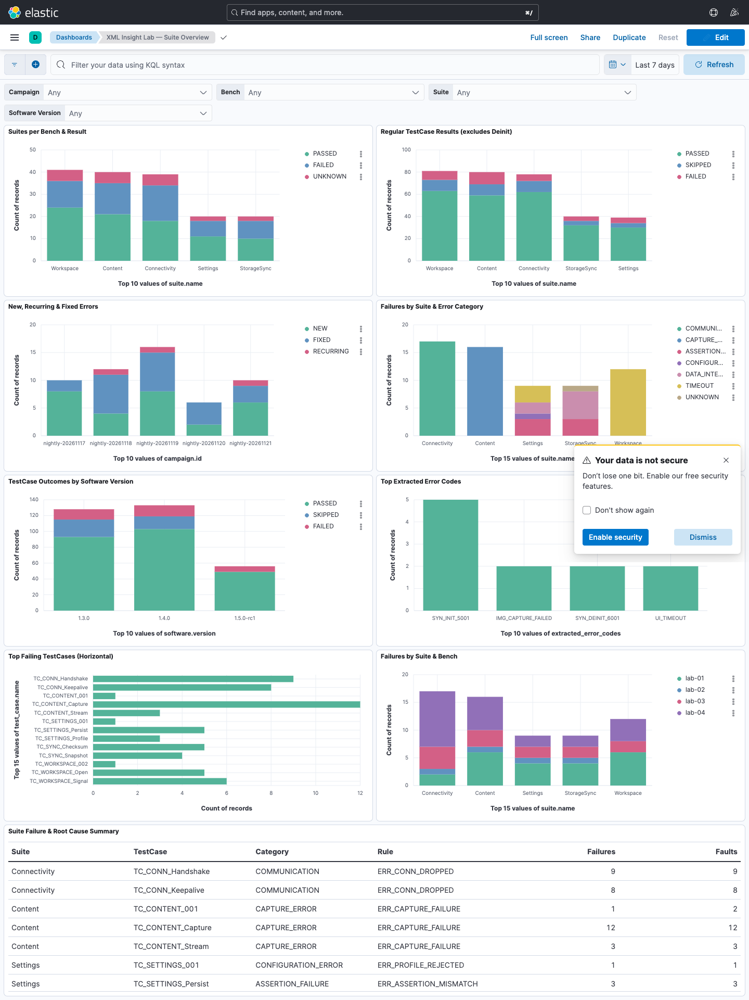
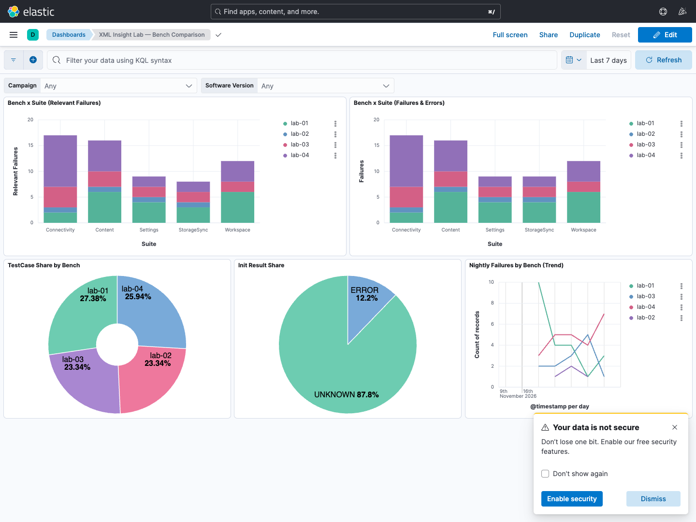
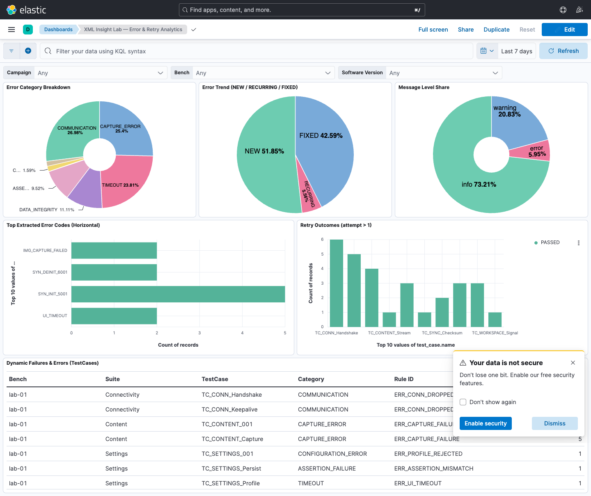
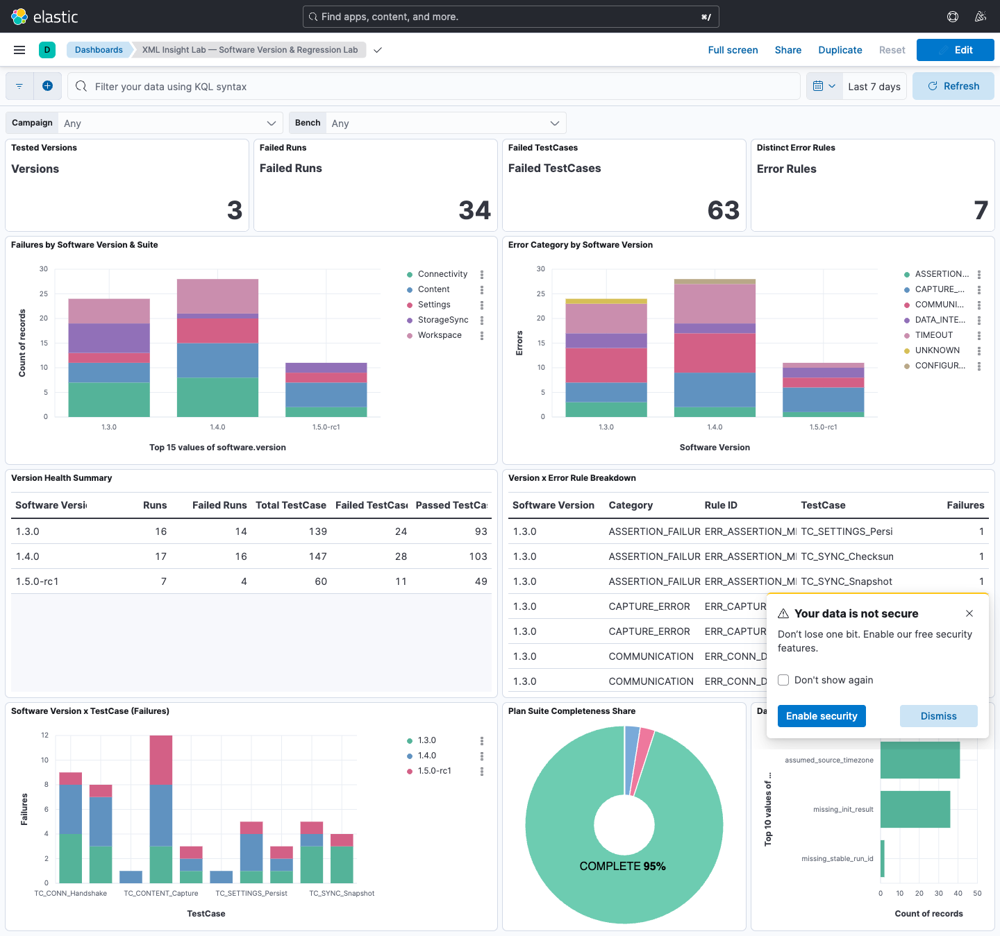
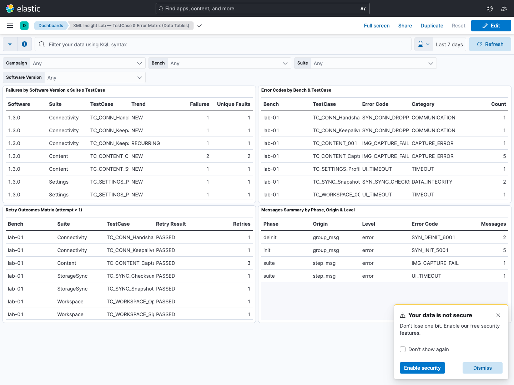
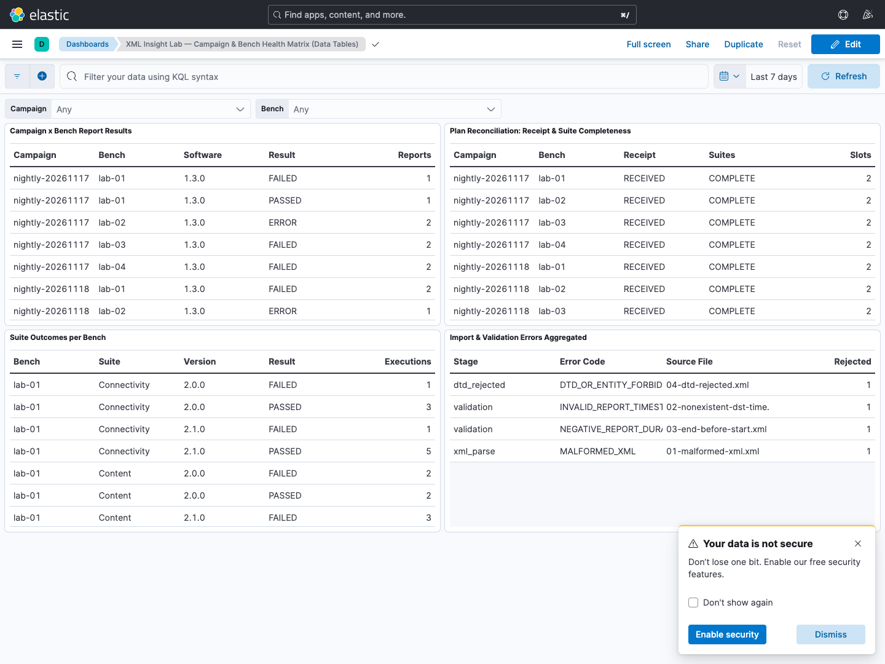
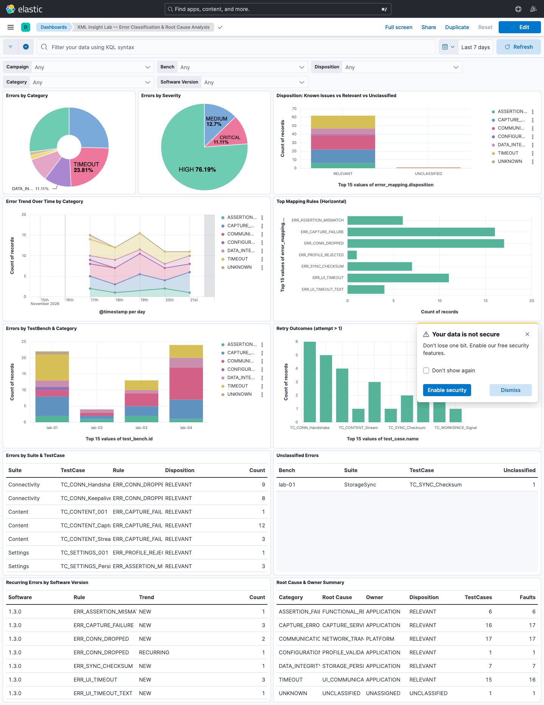
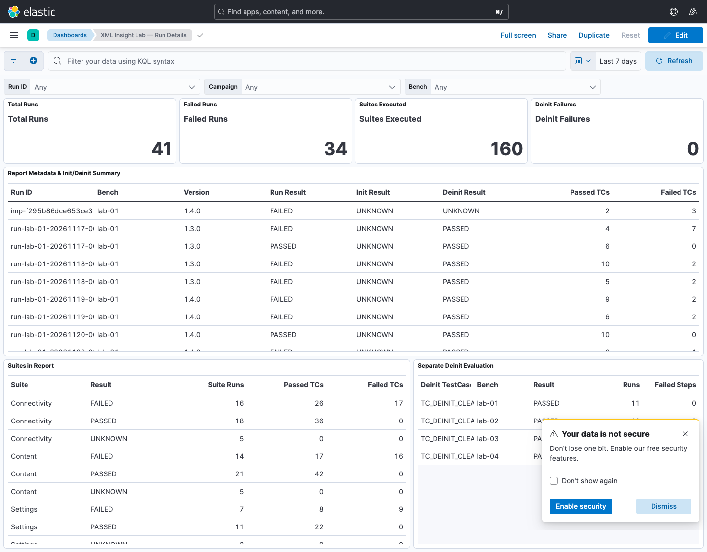
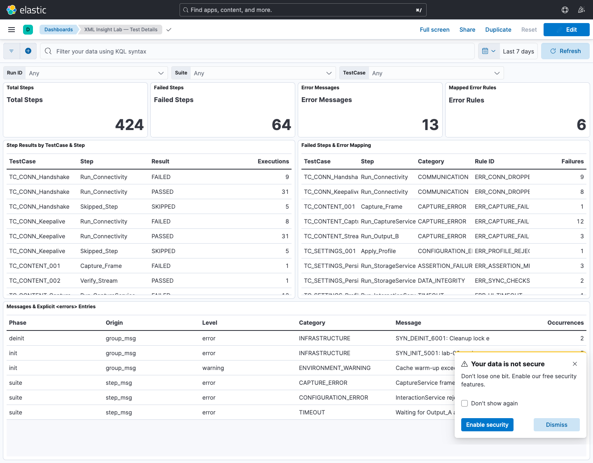

# XML Insight Lab

A locally runnable **Elasticsearch, Logstash, and Kibana** (`8.17.4`) analysis platform for synthetic `<report>` XML execution reports across multiple test benches, suites, software versions, and nightly campaigns.

> **Public & Synthetic Context Notice:** All projects (`SampleProject`), benches (`lab-01`–`lab-04`), suites (`Workspace`, `Content`, `Settings`, `Connectivity`, `StorageSync`), components (`Output_A`, `Output_B`, `CaptureService`, `InteractionService`, `StorageService`, `Connectivity`), and messages are 100% synthetic.

## Quickstart (Clean Setup)

From `/Users/cc/Desktop/ELK-Stack/project`:

```bash
./scripts/reset.sh --yes
./scripts/demo.sh
./scripts/verify.sh
```

- **Elasticsearch:** `http://127.0.0.1:9200`
- **Kibana Dashboards:** `http://127.0.0.1:5601/app/dashboards#/list?_g=(filters:!(),refreshInterval:(pause:!t,value:1000),time:(from:now-7d,to:now))`

> **Local Development Security Note:** Host ports bind exclusively to `127.0.0.1` and `xpack.security.enabled=false` is configured solely for local single-node development.

## Operational Commands

| Command | Purpose |
| --- | --- |
| `./scripts/demo.sh` | Build tools, start ELK, install templates, generate 5 nights × 4 benches × 5 suites, ingest, reconcile, provision 11 Kibana dashboards, verify |
| `./scripts/reprocess.sh` | Reload `config/error_mapping.yaml` in Logstash, reset indices, and re-classify all XML reports without duplicates |
| `./scripts/status.sh` | Container status, ES health, and document counts across all 7 index families |
| `./scripts/verify.sh` | Run Logstash Ruby unit tests (`test_error_mapping.rb`), verify ES document counts, and run the full `pytest` suite |
| `./scripts/stop.sh` | Stop containers while preserving `esdata` volume |
| `./scripts/reset.sh` | **Destructive:** remove containers, `esdata` volume, and `./data/` |

## Dashboard Screenshots (All 11 Dashboards)

### 01. Nightly Overview


### 02. Suite Overview


### 03. Bench Comparison


### 04. Error & Retry Analytics


### 05. Software Version & Regression Lab


### 06. Bench & Suite Failure Matrix (Aggregated Lens Data Tables)


### 07. TestCase & Error Matrix (Aggregated Lens Data Tables)


### 08. Campaign & Bench Health Matrix (Aggregated Lens Data Tables)


### 09. Error Classification & Root Cause Analysis


### 10. Run Details


### 11. Test Details


## Documentation

- [`docs/architecture-and-data-modeling.md`](docs/architecture-and-data-modeling.md) — System architecture, data flow, and Elasticsearch data modeling
- [`docs/error-mapping.md`](docs/error-mapping.md) — Configurable error-mapping engine, rule priorities, and dispositions
- [`docs/kibana-dashboards-and-customization.md`](docs/kibana-dashboards-and-customization.md) — Official Kibana terminology (`lnsDatatable` vs. `Saved Search`), field cheat sheet, and UI/NDJSON customization guide
- [`docs/xml-format-v1.md`](docs/xml-format-v1.md) · [`schemas/execution-report-v1.xsd`](schemas/execution-report-v1.xsd) · [`examples/sample-report-v1.xml`](examples/sample-report-v1.xml)
- [`docs/elasticsearch-model.md`](docs/elasticsearch-model.md)
- [`docs/kibana-discover-guide.md`](docs/kibana-discover-guide.md)
- [`docs/extending-xml-formats.md`](docs/extending-xml-formats.md)
