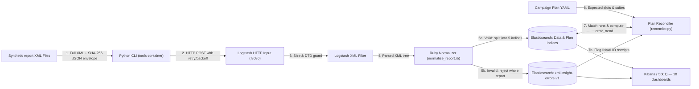
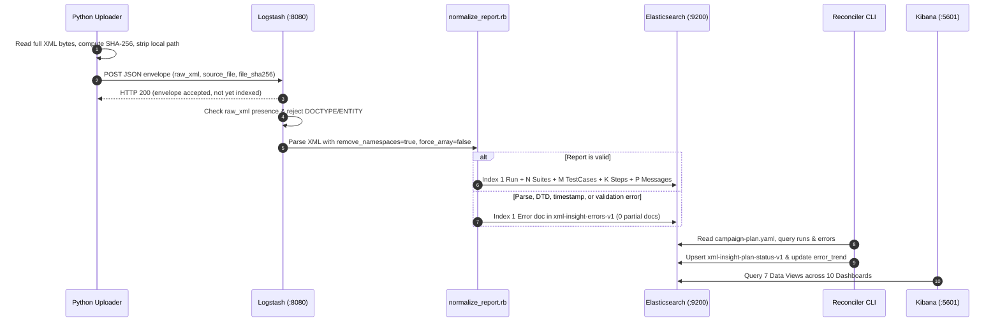
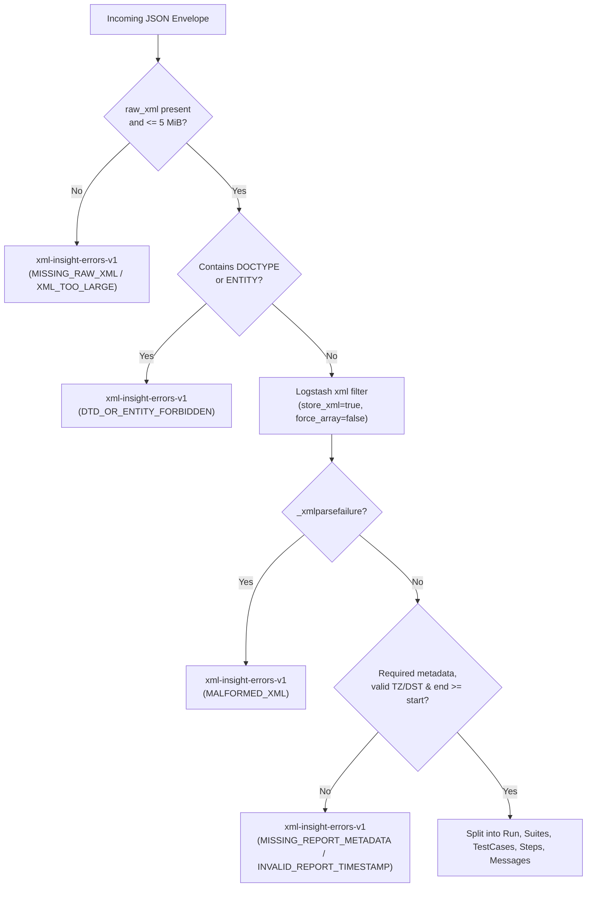
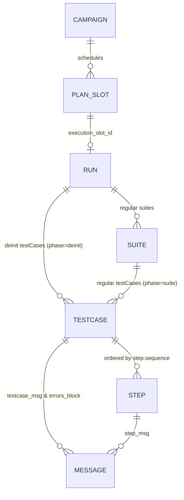
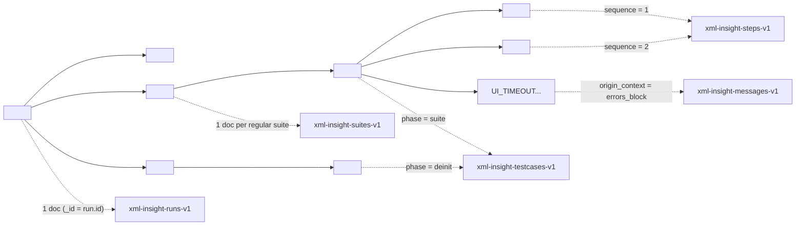
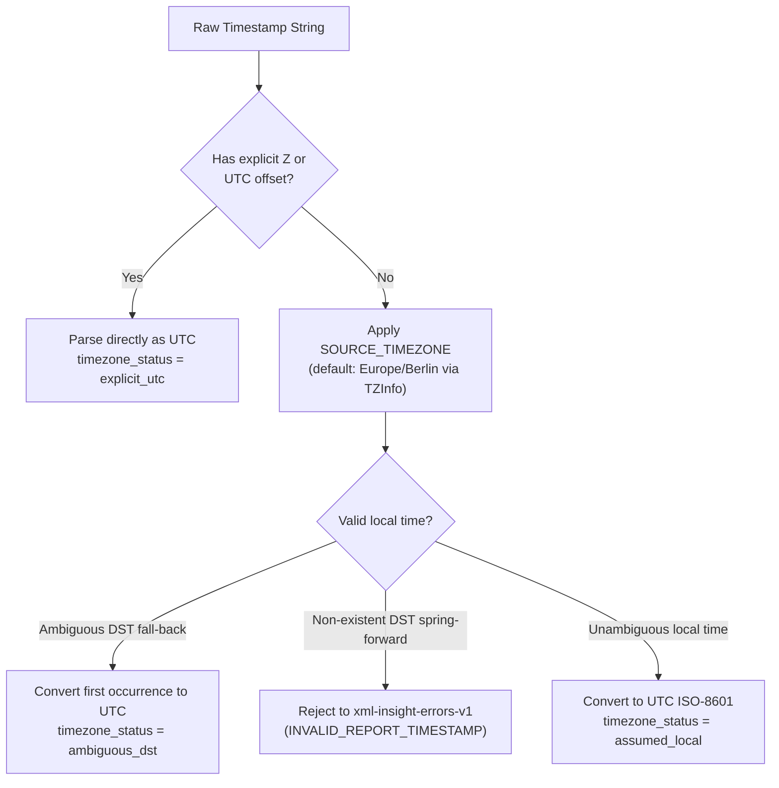
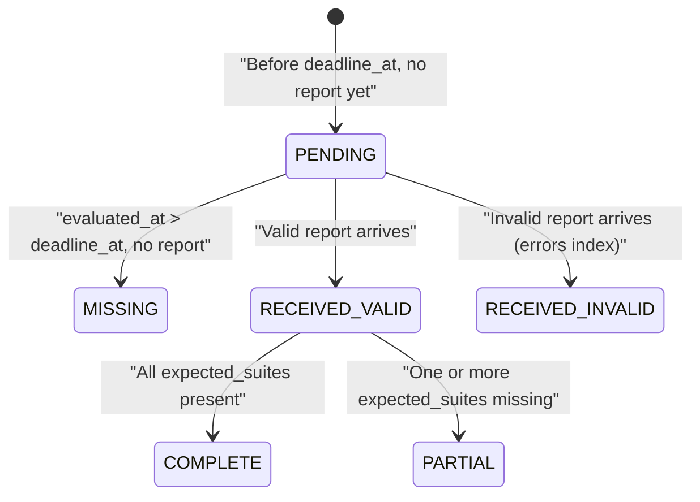
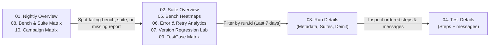

# Architecture & Data Modeling — XML Insight Lab

This document provides a deep-dive reference into the **system architecture**, **ingestion & validation pipeline**, **Elasticsearch data model**, **normalization rules**, and **Kibana analytics hierarchy** of **XML Insight Lab**.

---

## 1. End-to-End System Architecture

### End-to-End Execution Sequence

### Key Architectural Principles

1. **No Line-Based XML Tailing:** Multi-line XML files are read completely by `uploader.py` and sent as a single JSON envelope so Logstash never splits one XML report into multiple unrelated events.
2. **Logstash Owns Parsing & Domain Normalization:** The uploader never converts XML into Elasticsearch documents; it only handles transport, SHA-256 hashing, and bounded retries.
3. **Atomic Validation Before Splitting:** `normalize_report.rb` validates the entire `<report>` before emitting any child events. An invalid report never leaves partial suites or test cases in Elasticsearch.
4. **Stateless Multi-Worker Safety:** `normalize_report.rb` uses zero mutable global state and immutable `TZInfo::Timezone` objects, making it safe across multiple Logstash pipeline workers.
5. **Local-Only Exposure:** Host ports are bound strictly to `127.0.0.1` (`9200`, `5601`, `8080`). `xpack.security.enabled=false` is used exclusively for local development convenience.

---

## 2. Logstash Validation & Routing Pipeline

---

## 3. Logical Domain Hierarchy & XML-to-Elasticsearch Mapping

### Entity-Relationship Overview

### How One `<report>` Splits Across the 5 Data Indices

### Index Family Contracts (`"dynamic": "strict"`)

| Index Name | Counting Level | Deterministic `_id` | Key Fields & Purpose |
| --- | --- | --- | --- |
| `xml-insight-runs-v1` | 1 doc per `<report>` | `run.id` (or `imp-<sha256[:16]>`) | Run metadata, `init_normalized_result`, `deinit_normalized_result`, `suite_count`, `regular_tc_*`, `deinit_tc_*`, `init_params` (`nested`) |
| `xml-insight-suites-v1` | 1 doc per regular suite | `<run.id>::suite::<seq>::<suite.id>` | Suite name/version, `normalized_result`, `tc_total`, `tc_passed`, `tc_failed`, `tc_skipped` |
| `xml-insight-testcases-v1` | 1 doc per `<testCase>` | `<run.id>::<phase>::<suite_seq>::<exec_id>::<attempt>` | `phase` (`suite` \| `deinit`), `attempt`, `is_first_attempt`, `is_final_attempt`, `is_retry`, `error_category`, `error_trend`, `duration_ms` |
| `xml-insight-steps-v1` | 1 doc per `<step>` | `<run.id>::<phase>::<suite_seq>::<exec_id>::<attempt>::<step_seq>` | Preserves `step.sequence` and repeated same-named steps (e.g., two `Emit_Signal` steps), `assertions` (`nested`), `artifact_paths` |
| `xml-insight-messages-v1` | 1 doc per `<msg>` | `sha256(<composite_key>)[:32]` | `origin_context` (`group_msg`, `step_msg`, `testcase_msg`, `errors_block`), `position`, `level` (omitted if absent), `original_text`, `extracted_error_codes` |
| `xml-insight-errors-v1` | 1 doc per rejected XML | `<file_sha256>::<error_code>` | `error_stage`, `error_code`, `error_message`, `source_file` |
| `xml-insight-plan-status-v1` | 1 doc per planned slot | `<campaign.id>::<execution_slot_id>` | `receipt_status`, `suite_completeness`, `missing_suites`, `report_validity`, `is_late` |

### Why Denormalization Matters

Elasticsearch does not support SQL-style runtime joins across indices. Therefore, every child document (`suites`, `testcases`, `steps`, `messages`) carries denormalized parent context (`campaign.id`, `run.id`, `test_bench.id`, `project`, `software.version`, `suite.name`) so Kibana filters and Lens Data Tables slice any level directly without joins.

---

## 4. Timezone, Duration & Result Normalization

### Timezone Conversion Flow (`SOURCE_TIMEZONE` → UTC)

### Status & Duration Rules

- **Preserving Reported vs. Derived Results:** `source_result` stores the exact XML string. `normalized_result` maps missing values to `UNKNOWN` (e.g., `<groups name="initialization">` without `result` never invents `PASSED` or `FAILED`).
- **Warnings & Errors Separation:** A `<msg level="warning">` never turns `PASSED` into `FAILED`. Multiple `<errors><msg>` entries inside a single `<testCase>` create multiple documents in `xml-insight-messages-v1` while counting as **one** failed test case in `xml-insight-testcases-v1`.
- **Duration Assumption:** `duration` attributes are explicitly interpreted as **seconds** and converted to integer `duration_ms`. Missing `duration` leaves `duration_ms` absent (`null`), and report duration is never assumed to equal the sum of test case durations.
- **No Dynamic Field Explosion:** Unknown `<param name="..." value="..."/>` elements are stored as `nested` `{name, value}` objects in `init_params`, while `SoftwareVersion` is explicitly mapped to `software.version`.

---

## 5. Campaign Plan Reconciliation & Error Trends

- **Separate Receipt vs. Result:** A `RECEIVED_INVALID` report is recorded with `receipt_status: "RECEIVED"` and `report_validity: "INVALID"`, with `run_result` omitted so an invalid report never counts as `PASSED`.
- **`MISSING` Semantics:** `MISSING` strictly means no matching report arrived before `deadline_at`; it does not claim tests were never executed.
- **Error Trends (`NEW`, `RECURRING`, `FIXED`):** `reconciler.py` sorts regular final-attempt test cases chronologically per `(test_bench.id, suite.name, test_case.name)` and compares each outcome against the previous run:
  - Failed now, passed/absent before → `NEW`
  - Failed now, failed before → `RECURRING`
  - Passed now, failed before → `FIXED`

---

## 6. Kibana Analytics & Drilldown Flow

- **Lens Data Tables (`lnsDatatable`):** Used in Dashboards `08`, `09`, and `10` to aggregate failures, error codes, retries, and P95 durations by `test_bench.id` × `suite.name` × `test_case.name` without scrolling raw document rows.
- **Heatmaps (`lnsHeatmap`), Donuts (`lnsPie`) & Trends (`lnsXY`):** Surface cross-bench hotspots, software version regressions (`1.5.0-rc1` + `TC_CONTENT_Capture`), and multi-night duration creep (`Settings`).
- **Focused Saved Searches:** Used in `Run Details` and `Test Details` with slim 4–7 column layouts for ordered step-by-step and message-level root-cause inspection.
